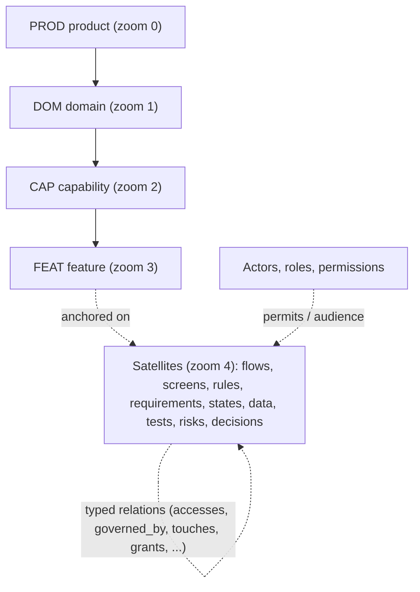

# Product Definition System (`pds`)

A way to define a SaaS product completely, from why it exists down to the rule one screen enforces, in plain files that a tool can check, draw and keep honest.

You write the definition as small Markdown records. The tool tells you how complete it really is, what is missing or contradicts itself, what to write next, who has signed off what, and what a change will touch. The pictures (flows, state machines, journeys, permission and entitlement matrices) are generated from the records, so they cannot drift.

> **Start here:** [`docs/01-assessment.md`](docs/01-assessment.md) answers whether the original proposal was complete and what was missing. [`examples/ledgerly/`](examples/ledgerly/README.md) is a worked example you can run commands against in a minute.

## The idea

A product is **one tree** (the *spine*) plus **satellites** that hang off it, plus a **typed graph** of relations across all of it.



- **Zoom** is depth on the spine. You can stop at any level and the definition is still coherent; you add depth where the risk is.
- **Aspect** is the family a satellite belongs to (intent, actors, structure, experience, behaviour, information, commercial, realisation, assurance, operations, change). A family is also a folder.
- **Relations** are stored once, on one side. The other direction is derived, so a fact is written in one place and every view that needs it reads it from there.

Everything else follows from taking three questions seriously: *is it complete* (computed, not asserted), *is it consistent* (checked, not hoped), *who accepted it* (recorded, bound to the content).

## Try it

Needs Node 20 or later. No dependencies, nothing to install.

```sh
cd product-definition-system/examples/ledgerly
node ../../tools/pds.mjs status               # where the definition stands, by family
node ../../tools/pds.mjs next                 # what to write next, most important first
node ../../tools/pds.mjs ask FEAT-pay-invoice-online   # the questions that take one element up the ladder
node ../../tools/pds.mjs spec FEAT-send-invoice        # a whole feature assembled into one document
node ../../tools/pds.mjs impact RULE-invoice-total     # what a change to this rule touches
node ../../tools/pds.mjs lint                 # no errors; warnings for what is left to do
```

Link it as `pds` with `npm link` from this folder if you prefer.

Start your own:

```sh
node tools/pds.mjs init my-product --name "My Product"
cd my-product
pds status      # 99 records already exist: a skeleton to confirm, correct or delete
pds next        # the queue: everything is outlined before anything is specified
```

`pds init` writes `pds.yaml`, the product record and a **skeleton**: a stub for each domain, capability, actor, role, surface, obligation and foundational question that a SaaS profile expects. The skeleton is the full-coverage template. It is made of prompts, not decisions, so every skeleton record is capped at *outlined* until a person confirms it, and `pds status` counts the ones nobody has.

## What you get

| | |
|---|---|
| **A model** | 42 element types in 11 families, 36 typed relations, 4 maturity rungs, 3 criticality tiers, 9 optional modules. [Reference](docs/reference/README.md). |
| **Coverage that is computed** | 279 rules say what each element must contain at each rung. 27 *concern probes* (failure behaviour, concurrency, tenancy, audit, ...) must each be answered, marked not applicable with a reason, or deferred with a date. Silence is not an answer. |
| **Consistency checks** | 63 coded checks in six classes: schema, references, integrity (dead-end flows, unreachable states, permissions nobody holds), quality, governance, probes. |
| **Honest status** | Maturity (how complete), approval (who accepted what, bound to a content hash) and lifecycle (active, deprecated, retired) are separate. A claim above what the content supports is an error. |
| **Views** | 21 generated views: product map, flows, state machines, ER, journeys, screens, touchpoints, permission, CRUD and entitlement matrices, traceability, registers, glossary, coverage, dependencies, releases, obligations, events, and a full specification per feature. Mermaid and Markdown tables, rendered on GitHub. |
| **Impact analysis** | What has to be re-reviewed if this element changes, strength-weighted, with approvals that go stale. |
| **Safe for agents** | `pds next` and `pds ask` give an agent its work queue and its questions. An agent drafts and proposes; it cannot approve, invent requirements or silently change what a person approved. [Protocol](docs/07-agents.md) and [skill](skills/pds-define/SKILL.md). |

## Documentation

| Read | For |
|---|---|
| [01 Assessment](docs/01-assessment.md) | Is the original proposal complete? The gaps, ranked, with the remedy and the evidence for each. |
| [02 Architecture](docs/02-architecture.md) | The model and the tool: spine, satellites, graph, status dimensions, approval units, meta-model as data. |
| [03 Authoring](docs/03-authoring.md) | How to write records: files, ids, sections, structured blocks, links, the YAML subset, which element type to use. |
| [04 Validation](docs/04-validation.md) | How completeness is computed: rules, ladder, probes, gates, checks, tiers, approval, waivers. |
| [05 Views](docs/05-views.md) | The generated pictures and tables, how to read them, how to add one. |
| [06 Procedures](docs/06-procedures.md) | Define a new product, recover an existing one, evolve either. Definition of done per rung. |
| [07 Agents](docs/07-agents.md) | The protocol for AI agents, and the guard rails the tool enforces. |
| [08 Build-out](docs/08-buildout.md) | What exists, how to extend it, measured limits, and the roadmap. |
| [09 Decisions](docs/09-decisions.md) | Why it is built this way, and what was rejected. |
| [Reference](docs/reference/README.md) | Every type, relation, rule, probe, view and module. Generated from the meta-model, so it cannot disagree with it. |

## Layout

```
meta-model/     the model as data: types, relations, rules, probes, views, modules, profiles
tools/pds.mjs   the command line;  tools/lib/  the engine;  tools/test/  the tests
examples/       a worked example (Ledgerly, an invented invoicing product)
docs/           the documents above;  docs/reference/ is generated
skills/         the agent skill
scripts/        tooling that is not the product (YAML parity check against PyYAML)
```

## Status

The model, the tool, the example and the documents are complete enough to use. `npm test` drives the real code on real files (the command line runs in process, and a copy of the example is broken one way at a time to prove that each check fires); `npm run check` also confirms the reference, the example's views and its lint result are current. The suite passes on Node 20, 22, 24 and 25.

What is not built is listed in [08 Build-out](docs/08-buildout.md) and is the honest edge of this work: baselines and diffs between releases, schema migration, import from existing documents, a browser viewer, and links from tests and code back into the definition. None of them changes the model.

This folder is self-contained. It does not read or change anything outside itself.
