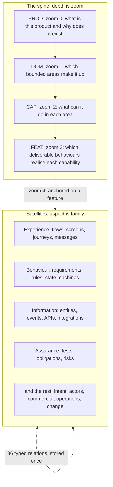
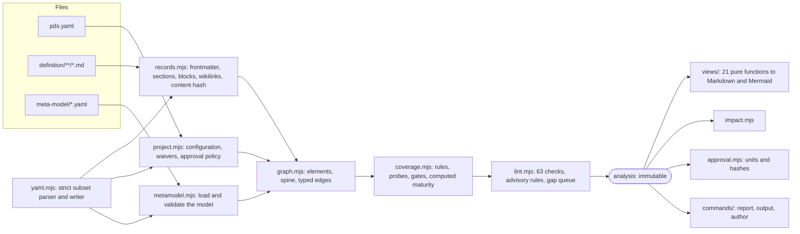

# 02. Architecture

What the system is made of, why it is shaped this way, and where each part lives. For how to write records see [03](03-authoring.md); for how completeness is computed see [04](04-validation.md). Every table of types, relations, rules, probes, views and modules is in the generated [reference](reference/README.md) and is not repeated here.

## 1. What the design has to satisfy

| # | Requirement | What it rules out |
|---|---|---|
| G1 | A definition is **coherent at every zoom level**: you can stop at the product, or at a capability, or at a rule on one screen, and what is there is true and complete for that depth. | A model that is only useful when finished |
| G2 | **One fact, one place.** Everything else is derived. | Documents that overlap and diverge |
| G3 | **Completeness is computed**, not asserted, and so is consistency. | A checklist the author ticks |
| G4 | **Status is honest.** How complete, who accepted it, where it is in its life and who wrote it are four separate answers. | One "status" field that means all four |
| G5 | **Plain files in git**, readable without the tool, diffable, mergeable. | A database, a hosted tool, a binary format |
| G6 | The tool is **small, boring and dependency-free**. | A framework, a build step, a runtime to install |
| G7 | **The model is data.** A type, rule, probe or view is added by editing YAML. | Rules buried in code that only a developer can change |
| G8 | **Safe to hand to an agent.** There is a work queue, a question per gap, and things an agent cannot do. | A skill that depends on the agent behaving |

## 2. The model

A product is **one decomposition tree** (the spine), **satellites** attached to it, and a **typed graph** of relations across all of it.

### 2.1 The spine

| Zoom | Type | Question it answers |
|---|---|---|
| 0 | `PROD` | What is this product, and why does it exist? There is exactly one. |
| 1 | `DOM` | Which bounded areas make it up? Domains nest, to at most three levels. |
| 2 | `CAP` | What can the product do in each area? Capabilities nest too. |
| 3 | `FEAT` | Which deliverable behaviours realise each capability? |
| 4 | satellites | The inside of a feature: everything anchored on it. |

Every element except the product has **exactly one anchor**: its home on the spine. The anchor is the only place hierarchy is written. A type states what it may anchor on (a screen on a capability or a feature; a metric on the product, a domain, a capability or a feature), and `SCH-anchor` enforces it.

**Zoom is how deep you are. It is not the kind of thing you are looking at.** A business rule is deep (it lives inside a feature) and is a piece of behaviour. The first is its position on the spine; the second is its family.

### 2.2 Families

A family is an aspect of the product, and it is also the **folder** the records live in. Each element type belongs to exactly one.

| Family (folder) | Question | Types |
|---|---|---|
| Intent (`intent`) | Why does it exist, what must it achieve? | `PROD` `OBJ` `OPP` `SEG` `ALT` `PRIN` |
| Actors (`actors`) | Who is involved, what may each do? | `ACT` `PERS` `ROLE` `PERM` `TEN` |
| Structure (`structure`) | What exists? | `DOM` `CAP` `FEAT` `SRF` |
| Experience (`experience`) | How is it used, step by step? | `UC` `JRN` `FLW` `SCR` `MSG` |
| Behaviour (`behaviour`) | How must it behave? | `REQ` `RULE` `STM` |
| Information (`information`) | What does it know, send, depend on? | `ENT` `EVT` `API` `EXT` `INT` `TERM` |
| Commercial (`commercial`) | How is access packaged and paid for? | `PLAN` `ENTL` |
| Realisation (`realisation`) | What implements it? Reference only. | `SYS` |
| Assurance (`assurance`) | How well must it work, how is that proven? | `OBL` `TST` `RISK` |
| Measurement and operations (`operations`) | How do we know it works, keep it running? | `MET` `RUN` |
| Change and evidence (`change`) | What did we decide, assume, ask, learn, ship? | `DEC` `ASM` `QST` `EVD` `RLS` |

Forty-two types in all, in three **adoption levels**: `core` (17), `standard` (adds 21, 38 in total), `full` (adds 4, 42 in total). A project chooses a level in `pds.yaml`; types above it are unavailable and the rules and probes that depend on them go quiet. Moving up a level rewrites nothing. See [reference/element-types.md](reference/element-types.md).

### 2.3 Relations

The spine says where something sits. **Relations** say how things connect: a feature `accesses` an entity, a flow step `touches` a screen, a role `grants` a permission, a plan `grants` an entitlement, a test `verifies` a requirement.

- **Stored once.** A relation is written on the element it leaves, under `rel`. The inverse name (`served_by`, `touched_by`) is **derived** and refused if written, with a pointer to the other side. There is no second copy to forget.
- **Also read from structure.** The tool derives edges from reference fields (`ref`, `refs` types with an `edge`), from the structured blocks (`pds-flow` produces `audience`, `touches`, `governed_by`, `accesses`, `emits`, `drives`, `depends_on`; `pds-states` produces `emits` and `governed_by`; `pds-attributes` produces `associates`; `pds-journey` produces `spans` and `touches`), and from `[[ID]]` wikilinks in prose (`mentions`). A fact in a flow step is not also written under `rel`.
- **Typed.** Each relation declares the pairs of types it may connect and the attributes an edge may carry (`accesses` carries `ops`: create, read, update, delete). `SCH-rel-pair` enforces it.
- **Weighted for change.** Each relation says how strongly each end is affected when the other changes: `strong` (must be reviewed), `weak` (should be), or `none`. That is what [`pds impact`](#6-impact-analysis) walks.
- **Used.** A relation that no rule, check or view reads is dropped; `pds meta check` enforces it, so the model carries nothing it does not use.

The 36 relations fall into six groups: why it exists, actors and permissions, structure and system, information, assurance and scope, experience and coupling. See [reference/relations.md](reference/relations.md).

### 2.4 Records

One element is one **Markdown file** with a **YAML frontmatter** header.

- The **id** is `TYPE-slug`, for example `FEAT-send-invoice`, and equals the file name. It is frozen at creation, never reused, and never has to follow a later change of title. Everything links by id.
- The **frontmatter** holds the envelope (id, title, summary, anchor, maturity, tier, approval, lifecycle, origin, owner, reviewed, links, rel) and the fields the type defines.
- The **body** is `##` sections. A type says which sections it needs, from which rung, and the question each must answer.
- **Structured blocks** are fenced code in the body, for the content that has to be machine-readable: `pds-flow`, `pds-states`, `pds-attributes`, `pds-journey`, `pds-payload` (and `gherkin` for tests, kept as text).
- The YAML is a **strict subset** that refuses the values and keys on which parsers disagree (`yes`, `no`, `on`, `off`, `007`, `1:30`, `1e3`). It is parity-tested against PyYAML. See [03](03-authoring.md#13-the-yaml-subset).

### 2.5 Four separate statuses

The most common failure of definition systems is one status field that tries to mean four things. Here they are four dimensions, each stored and checked independently.

| Dimension | Values | Answers | Set by |
|---|---|---|---|
| **Maturity** | `stub` → `outlined` → `specified` → `verifiable` | How complete is the definition? | **Declared** by the author, **computed** by the rules. Declaring more than is computed is an error. |
| **Approval** | `draft`, `proposed`, `approved` | Did an authorised person accept this, and is it still what they accepted? | A named human, bound to a content hash |
| **Lifecycle** | `active`, `deprecated`, `retired` | Where is it in the product's life? | The author, with a note saying why and what replaces it |
| **Origin** | `human`, `agent`, `skeleton`, `import` | Who or what wrote it? | Recorded; `skeleton` is capped at `outlined` |

Maturity is *definition completeness*, not delivery status: a feature can be `verifiable` and not built, or built and `stub`. Delivery belongs in a tracker; the definition says what is to be built and how it will be known to work.

**Tiers** are a fifth, orthogonal setting on the element, not a status: 1 critical, 2 important, 3 supporting. They set how deep a definition has to go in proportion to the cost of being wrong, which probes apply, how often it must be reviewed (60, 120, 240 days), and whether approval is required. A tier is inherited down the anchor chain when not set; a child cannot be more critical than what it sits under (`COH-tier-order`).

### 2.6 Approval units

Approval is bound to a **hash of content**, and the unit of approval is the **unit of build**.

- `policy.approval.units` in `pds.yaml` (default `CAP`, `FEAT`) names the types whose approval covers everything anchored beneath them. Approving a feature is a person saying "I read this specification and it is right", and the specification of a feature is the feature plus its flows, screens, rules, requirements and tests.
- **Every element is covered by exactly one approval**: its nearest ancestor of a unit type, or itself when it has none. A capability's approval covers the capability and what is shared at its level; each of its features is approved on its own. Domains and the product are not units, because one approval covering that much would go stale on every edit anywhere.
- The **hash** of a single record is sha256 over its frontmatter (without `approval` and `reviewed`, with sorted keys) and its body (trailing whitespace and extra blank lines normalised). The hash of a unit is sha256 over the sorted `id contentHash` pairs of everything it covers. Reformatting changes nothing; changing what a record says does. A hash is written as `sha256:` and the first 16 hex digits, which is plenty to notice an edit.
- After an edit anywhere inside a unit its approval shows as stale (`GOV-approval-hash`) until it is approved again.
- **Who:** only people listed under `approvers` in `pds.yaml`. With `PDS_AGENT` set in the environment, `pds approve` refuses outright, even with `--force`.
- **When it is required:** `policy.approval.required_for_tiers` (default tier 1) from the rung in `policy.approval.from` (default `specified`). A critical element that claims `specified` without approval is a warning (`GOV-tier1-approval`).

## 3. The meta-model is data

Everything that defines *what a definition is* lives in `meta-model/` as YAML, not in code. The tool is a generic engine over it.

| File | Defines | Count |
|---|---|---|
| `model.yaml` | The spine, families, ladder, tiers, approval and lifecycle values, facets, adoption levels, modules | 5 zoom levels (0 to 3 on the spine, 4 inside a feature), 11 families, 12 facets, 3 adoption levels, 9 modules |
| `element-types.yaml` | Every type: its family, adoption level, anchors, fields (with the rung each is required from), sections (with the question each answers), structured blocks | 42 types |
| `relation-types.yaml` | Every relation: inverse, allowed pairs, attributes, impact strengths, and the impact walk's parameters | 36 relations |
| `rules.yaml` | Coverage rules, the names of the coded checks, the three gates | 73 rules, 63 checks, 3 gates |
| `probes.yaml` | Concern probes: when each applies, who can address it, the question | 27 probes |
| `views.yaml` | The views: what each is for, what it can be scoped to | 21 views |
| `profiles/*.yaml` | A profile's defaults and the skeleton it starts a project with | 1 profile (`saas`) |

From these the tool generates: the **templates** that `pds new` writes; the **schema checks**; **206 implicit coverage rules** (a field required at a rung, a section required at a rung, a block required at a rung); the **elicitation questions** that `pds ask` prints; and the **reference documentation**. Change `element-types.yaml` and all of them change.

**The model checks itself.** `pds meta check` verifies that the data is consistent and that it agrees with the engine, in both directions: every type, relation, facet, field and module that a rule, probe, view or seed names exists; ids are unique; every relation is read by some rule, check or view; a rule that requires a relation can be satisfied by some allowed pair of types; every declared check and view is implemented and every implemented check is declared; every skeleton seed is a valid record. A model that has drifted from its engine fails here before it fails on a user's project. Tests separately confirm that the commented block examples `pds new` writes into templates parse and validate.

**Rules are small and declarative.** A rule says which elements it applies to (`type`, a rung, an optional `where`, optional `tiers`, a `module`) and what must hold (`require`): a field present, a section present, a block present, a relation with a number of targets of given types, children of a type. A rule with `ask:` text is also a question the tool can put to the author. Rules never contain code. The 63 checks are code, because they need to traverse a flow or compare two lists; each is declared in `rules.yaml` with a class, a severity and an explanation, so it can be listed and explained.

**Profiles** are a starting point. The `saas` profile decides the default adoption level and modules and supplies the skeleton: stubs for the domains, capabilities, actors, roles, surfaces, obligations and foundational questions a SaaS product expects. A product of another shape (a marketplace, an API-only product, an internal tool) is a new profile, not a change to the engine.

## 4. The tool

- **One analysis, many consumers.** `analyse()` takes the files in memory and returns data: the model, computed maturity per element, every finding, the gap queue. It touches no disk and does not print. The views, the impact walk, the approval check and every report read the same analysis, so they cannot disagree.
- **Views are pure functions of the analysis.** The same records produce the same bytes. Nothing in a view is typed by hand. A view carries a banner and is never edited.
- **Only six commands write:** `init`, `new`, `rename`, `approve`, `views` and `docs`. The rest are read-only. `rename` and `approve` edit records surgically (one key, the file's own line endings, comments and order preserved) and `rename` restores every file if the result would be worse.
- **The commands run in process.** `main(argv, { out, err, env, cwd })` returns an exit code, so a test calls the real command line without a child process and a failure has a stack.
- **Exit codes:** `0` done and nothing wrong; `1` the work ran and found problems (lint errors, a refused approval, a stale generated file under `--check`); `2` the command was used wrongly; `3` something unexpected broke. What is wrong with the definition makes `lint` and the `--check` flags exit `1`, and no other command: `status`, `next` and `ask` describe the state and exit `0`. Set `PDS_DEBUG` for a stack trace.
- **Environment:** `PDS_ROOT` (the project, instead of searching upward), `PDS_TODAY` (a fixed date for repeatable review-age checks), `PDS_AGENT` (refuse approval), `PDS_DEBUG`.
- **Zero dependencies.** Node 20 or later, `node:test` for the tests. The only parsers are the project's own: the YAML subset and the record reader.

The 15 commands, grouped as `pds help` groups them (`pds help` and `pds version` are always there as well):

| Group | Commands |
|---|---|
| Write | `init`, `new`, `rename`, `approve` |
| Check | `lint`, `status`, `next`, `ask` |
| See | `view`, `views`, `spec`, `impact` |
| Understand | `explain`, `meta`, `docs` |

## 5. Where completeness comes from

Four mechanisms, each in its own module, each configured by data. [04](04-validation.md) has the detail; this is the shape.

1. **Coverage rules** (`coverage.mjs`). For each element, every rule that applies is evaluated. A rule is bound to a rung. **Computed maturity is the highest rung for which every error-severity rule at that rung and below holds**, capped by the gates and by a ceiling: only a type that has a rule at the top rung can be computed `verifiable`.
2. **Probes.** A concern probe applies to a feature by tier, kind and facet, and needs a disposition (`addressed`, `na` with a reason, `deferred` with a date). A missing one is an error-severity rule at `specified`, so it holds the feature back.
3. **Gates.** `GATE-skeleton` and `GATE-blocking-question` cap an element at `outlined`. `GATE-retired` removes a retired element from coverage and the queue.
4. **Checks** (`checks/`). 63 coded checks, in six classes, over the graph and the records. They produce findings rather than a rung. The ones that tie them to the rung are `GOV-claim`, `GOV-skeleton` and `GOV-blocking-question`, which between them make a declared maturity above the computed one an error.

**Facets** connect the model to the probes. A facet is a yes/no characteristic of a feature (`has_ui`, `writes_data`, `handles_pii`, `handles_money`, `tenant_data`, `stateful`, `external_dependency`, `sends_messages`, and so on) **derived from the graph** when it can be, and **declared** when it cannot (`async`, `user_content`, `public`). Declaring a derived facet false when the graph says true is an error (`COH-facets`). That is what makes the probes automatic: nobody has to remember that a feature touching personal data needs the privacy question.

## 6. Impact analysis

`pds impact ID` answers "what has to be reviewed if this changes?" It is a bounded breadth-first walk over the graph.

- Each relation declares how strongly each end is affected (`impacts: {to, from}`), and the spine declares the same for the anchor chain (`anchor: {down: strong, up: weak}`): change a feature and what is anchored on it must be reviewed; change one of those and the feature that holds it should be.
- A **strong** edge keeps propagating for up to `strong_hops` (2) hops; a **weak** edge is followed for `weak_hops` (1).
- **A path is as strong as its weakest edge**, and goes only as far as that strength allows.
- **Containers are not neighbours.** Walking down the anchor chain from the thing that changed is strong, because what a feature contains changes with it. An element reached through any other relation is only a neighbour: that a rule governs a feature does not make every risk, metric and screen inside the feature a must-review.
- Retired elements are excluded.
- The result is a **must-review** list, a **should-review** list, and who owns what is affected (the nearest feature or capability), with the path that explains each entry.

The parameters are in `relation-types.yaml`, so they can be tuned without code.

## 7. Views

A view is a function from the analysis to Markdown, usually with a Mermaid diagram or a table. The 21 views are declared in `views.yaml` (what each is for and what it can be scoped to) and implemented in `tools/lib/views/` in three files: diagrams, matrices, documents. See [05](05-views.md).

`pds view NAME [ID]` prints one; `pds views` writes all of them, plus one specification per capability and feature, into the project's `views/` folder; `pds views --check` fails if any is out of date. Links between generated files are computed from where each file is written, so they resolve wherever the output goes.

## 8. Extension points

Extending is editing data, with `pds meta check` and `pds docs` as the safety net.

| To add | Edit | Also |
|---|---|---|
| A field or a section to a type | `element-types.yaml` | `pds docs` |
| A coverage rule | `rules.yaml` (`rules:`) | a test if it needs one |
| A coded check | declare in `rules.yaml` (`checks:`), implement in `tools/lib/checks/` | a test that breaks the example one way and asserts it fires |
| A probe | `probes.yaml` | `pds docs`; the example may need a disposition |
| A relation | `relation-types.yaml` | something must read it (a rule, check or view), or `pds meta check` fails |
| An element type | `element-types.yaml`; a template and the schema checks follow | skeleton seeds if a profile should start with it |
| A view | declare in `views.yaml`, implement in `tools/lib/views/` | a test |
| A module | `model.yaml` | rules and probes opt in with `module:` |
| A profile | `meta-model/profiles/` | defaults and skeleton |

`--meta DIR` points the tool at a different meta-model folder, so a team can keep its own model next to its own definition.

**Versioning.** `pds: 1` in `pds.yaml` is the format version. A change to the model that renames or removes something changes the content hash of records that use it, and so invalidates approvals; a migration command that applies a rename across records and re-seals the approvals is on the [roadmap](08-buildout.md#8-roadmap) and is not yet built.

## 9. What it is not

- **Not a task tracker.** Maturity is about the definition. Delivery belongs in an issue tracker, which a record can point at with `links`.
- **Not a design tool.** Wireframes, mock-ups and brand are design artefacts. Records point at them; they are not generated from the definition.
- **Not a code generator.** The realisation family is reference only: a system component says what implements something and points at the design, and `QLT-sys-reference` keeps it short.
- **Not a documentation site.** Output is Markdown and Mermaid in the repository, rendered by whatever renders Markdown. A browser viewer is on the roadmap.
- **Not a judge of truth.** It checks structure, coverage, consistency and honesty. See [01](01-assessment.md#7-what-is-still-open).
