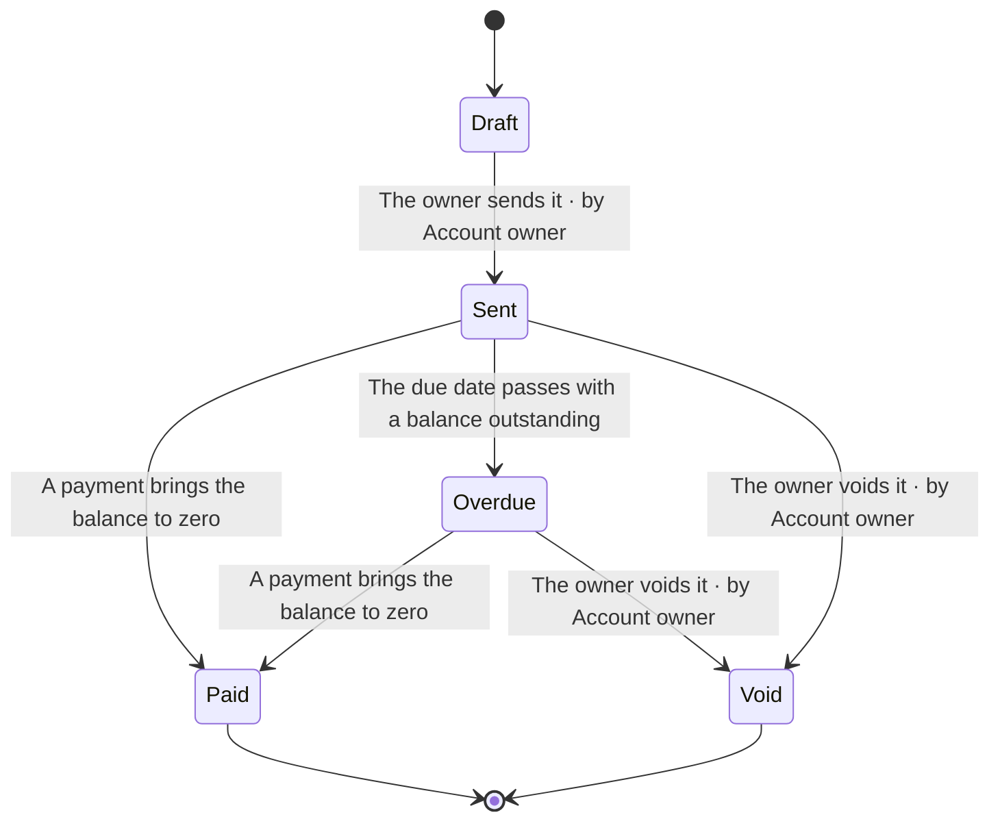

# 05. Views

A **view** is a picture or a table generated from the records. It is the visualisation half of the system, and it exists on one condition: **a view is never written, only generated**, so it can never disagree with the definition. Change a record, regenerate, and every view that depends on it changes.

The worked example's generated output is in [`examples/ledgerly/views/`](../examples/ledgerly/views/README.md); GitHub renders the diagrams in place. The exact list, with what each reads, is in the [reference](reference/views.md).

## 1. Using them

```sh
pds view                      # list the views
pds view flow FLW-send-invoice   # print one, for one element
pds view permissions          # print one, for the product
pds spec FEAT-send-invoice    # shorthand for: pds view spec FEAT-send-invoice
pds views                     # write all of them into the views folder
pds views --check             # fail if any is out of date; write nothing
```

- **`pds view NAME [ID]`** prints one view to the terminal, or to a file with `--out FILE`. `spec` and `card` need an element. The others cover the whole product without `ID`, and with one they cover just that element (a flow, a state machine, a journey, a release), or a domain, for the views that can be pointed at one. A view that takes no target (`permissions`, say) refuses one, and says so.
- **`pds views`** writes the 19 product-wide views, one **specification** for each capability and each feature, and an index `README.md`, into `views_dir` (default `views/`). It removes generated files that no longer correspond to anything. **Files you wrote yourself there, which lack the generated banner, are never touched.**
- **`pds views --check`** exits `1` if the folder is out of date and says which files. Run it in the pull-request check. `--out DIR` writes elsewhere; links are computed from wherever the file lands.
- Every generated file starts with `<!-- Generated by pds (NAME). Do not edit: change the records and regenerate. -->`.
- **The output is deterministic.** The same records give the same bytes, so a diff of `views/` shows exactly what a change to the definition did to the pictures, and review can use it.
- Output is **Markdown and Mermaid**. Mermaid renders in GitHub, GitLab, most editors, and at [mermaid.live](https://mermaid.live). Four kinds are used: `flowchart`, `stateDiagram-v2`, `erDiagram`, `journey`.

## 2. Which view answers which question

| You want to know | View | Pointed at |
|---|---|---|
| **Orientation** | | |
| What is in the product, at every level, and how complete each part is | `product-map` | product, or any domain, capability, feature |
| Who and what the product exchanges things with, from the outside | `context` | product |
| How complete the definition is, what is next, and what is not yet written at all | `coverage` | product |
| What is still open: questions, assumptions, risks, decisions | `registers` | product, or any element |
| What each word means, and which words not to use | `glossary` | product, or a domain |
| **Experience** | | |
| How a flow runs: who does what, where it branches, how it ends | `flow` | a flow |
| What a person goes through, stage by stage, and where it hurts | `journey` | a journey |
| Which screens exist and how a person moves between them | `screens` | product, or a feature |
| Where the product meets a person or a system, which flows use each place, who is there | `touchpoints` | product |
| **Behaviour and data** | | |
| Which states something can be in and what moves it | `state` | a state machine |
| What information the product keeps and how it relates | `er` | product, or a domain |
| Who creates, reads, updates and deletes which entity | `crud` | product, or a domain |
| Which events exist, who emits them, who reacts, which metric counts them | `events` | product |
| **Access and commercial** | | |
| Which role may do what, and which feature needs which permission | `permissions` | product |
| What each plan includes, and what each entitlement gates | `entitlements` | product |
| **Traceability and change** | | |
| From each objective down to the capabilities, features, requirements and tests that carry it, and back | `trace` | product, or any element |
| What depends on what, and what a change would reach | `deps` | product, or a domain |
| What is in a release and how ready each part is | `release` | a release |
| Which duties apply, what meets each, what proves it | `obligations` | product |
| **For one element** | | |
| Everything about one element on one page | `card` | any element |
| The complete specification of a feature, assembled from its parts | `spec` | a feature, or a capability |

## 3. What the diagrams look like

A state machine, generated from `STM-invoice-lifecycle`:



A flow is drawn with a lane per actor, decisions marked, and each end coloured by how it ended (success, failure, abort), followed by a table of every step with what it uses, what data it touches and what it emits. See [`examples/ledgerly/views/flow.md`](../examples/ledgerly/views/flow.md).

**A table is a view too.** The permission matrix, from the role and permission records and the `requires` relations on features:

| Permission | Scope | Sensitive | Admin | Invoice recipient | Member | Owner |
| --- | --- | --- | --- | --- | --- | --- |
| Manage billing |  |  |  |  |  | yes |
| Pay an invoice | self |  |  | yes |  |  |
| Send an invoice | workspace | yes |  |  |  | yes |

An empty row in a matrix is information. A permission no role holds, an entity no feature creates and an entitlement no plan grants are each also a coverage rule, so the matrix shows the gap and `pds lint` says so.

## 4. The specification

`pds spec ID` is the part of the system that answers *"describe this feature in full"*. It assembles everything anchored on the feature, and everything that governs it, into one document:

| § | Section | Drawn from |
|---|---|---|
| | Header | the summary; where it sits; kind, tier, owner; maturity (supported and claimed); approval; last review |
| 1 | Purpose and value | its *Purpose and value* section; the objectives and opportunities it (or its capability) `serves`; its audience |
| 2 | Entry and access | its *Entry conditions* section; the permissions it, or anything directly beneath it, `requires`, with the roles that hold them; the entitlements that gate it, with each plan's value |
| 3 | Flows | each flow anchored on it, as a diagram, with the flow's own notes |
| 4 | Screens and messages | a table of screens (kind, surface, states) and one of messages (channel, class, trigger, audience) |
| 5 | Business rules | each rule anchored on it, and each rule that governs it from elsewhere, with its statement and worked examples |
| 6 | State | the state machines anchored on it, and those that describe an entity it accesses, as diagrams |
| 7 | Data | the entities it accesses, the operations on each, whether they hold personal data, their classification and retention; an entity diagram |
| 8 | Events and integrations | what it emits and consumes, what it depends on, which APIs expose it |
| 9 | Requirements | each requirement, with kind, priority, how it is verified and its statement |
| 10 | Concerns | each applicable concern probe, and how it was answered or why it was not |
| 11 | Verification | each test anchored on it or verifying it or anything beneath it |
| 12 | Decisions, assumptions, questions and risks | each one that `concerns` it or anything beneath it, and its status |
| 13 | Release and maintenance | its *Release and maintenance* section; the release that `includes` it |
| | Completeness | what stands between it and the next rung |

A capability's specification is its *Purpose and outcome*, a table of its features, and then each feature's specification. **A section with nothing in it says so** (`_No flow yet._`, `_Not written yet._`, `_Not gated by plan._`) rather than disappearing, so a gap is visible in the document as well as in `pds lint`.

This is the same material a person would write across half a dozen documents and keep in sync by hand. Here it is one query.

## 5. The coverage report

`pds view coverage` is the view to open in a review. It is the same information as `pds status`, as a document, with more in it:

- depth by family, by tier and by element type;
- **the spine**: each domain, capability and feature, what it supports, and how many of its children are specified;
- **concern probes**: how many are answered, and which are outstanding most often;
- **what to write next**: the head of the queue;
- **blind spots**: the stubs and unconfirmed skeleton records, listed, and a reminder that depth says nothing about what has not been written at all.

The last point is the weakness of any coverage figure: it measures what exists. That is why the skeleton exists (a place for everything a SaaS product usually has, written down as a stub so the absence is counted) and why probes exist (questions that name what is usually forgotten).

## 6. Rules the generator follows

- **Pure.** A view is a function of the analysis. It reads no clock, no environment and no disk.
- **No date in the output.** A generated file that named today would be out of date tomorrow, and `pds views --check` would fail on the calendar alone. The generated set is the same bytes on any day, and a test holds that. (What a day *can* change is a finding that depends on time: a review that has lapsed or a question that has passed its due date. Those are real changes to the definition's health, and the coverage report shows them.)
- **Scoped by what is used, not only by where it sits.** A feature's entity diagram and state diagram include the entities it *accesses* and the state machines that describe them, even when those are anchored on the domain.
- **Retired elements are left out** of the product-wide views and get no specification. They stay in their files.
- **Links are computed from where the file is written.** Where a view names an element by its id, the id is a link to that record's file, with the right number of `../` for the folder; a `[[ID]]` in prose becomes a link; and the tests check that every relative link in the generated set resolves (over 300 of them in the example).
- **Escaping.** Titles and notes are cleaned for Mermaid and for table cells (pipes, quotes, line breaks), and node ids are generated, so text a person wrote cannot break a diagram.

## 7. Adding a view

1. Declare it in `meta-model/views.yaml`: its id, title, the question it answers, what it can be pointed at (`product`, a domain, an element type), its form, and which relations it reads. A view that reads a relation counts as a consumer of it, which is what keeps the model free of dead relations.
2. Implement it in `tools/lib/views/` (diagrams, matrices or documents) as a function of the analysis.
3. Add a test in `tools/test/views.test.mjs`: it renders for the example, its Mermaid is well formed, its links resolve, and it is stable.
4. `pds meta check` (every declared view is implemented), `pds docs` (regenerates the reference), `pds views` in the example, and commit the output.

## 8. What views are not

- **They are not where you edit.** The banner says so, and `pds views` will overwrite an edit.
- **They are not a substitute for design.** A flow diagram shows the logic. A wireframe shows the screen. Wireframes and mock-ups belong in a design tool and are linked from the screen record with `links`.
- **They are not complete on their own.** A matrix with no empty cells can still be a matrix of the wrong things. The views make a definition legible; `pds lint` and `pds status` say whether it is sound.
