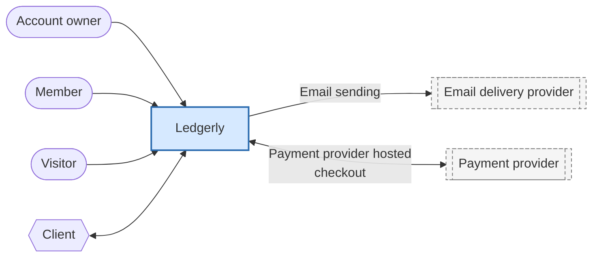

<!-- Generated by pds (context). Do not edit: change the records and regenerate. -->

# System context: Ledgerly

## Who uses it

| Actor | Kind | Side | Features and capabilities for them |
| --- | --- | --- | --- |
| [`ACT-account-owner`](../definition/actors/ACT-account-owner.md) Account owner | human | customer side | 5 |
| [`ACT-client`](../definition/actors/ACT-client.md) Client | external | customer side | 3 |
| [`ACT-member`](../definition/actors/ACT-member.md) Member | human | customer side | 1 |
| [`ACT-visitor`](../definition/actors/ACT-visitor.md) Visitor | human | customer side | **none** |

## External systems

| System | Kind | Criticality | Integrations | Needed by |
| --- | --- | --- | --- | --- |
| [`EXT-email-delivery`](../definition/information/EXT-email-delivery.md) Email delivery provider | email | important | Email sending |  |
| [`EXT-payment-provider`](../definition/information/EXT-payment-provider.md) Payment provider | payments | critical | Payment provider hosted checkout |  |
