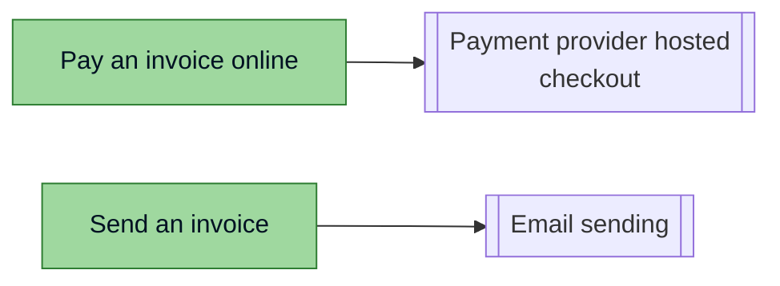

<!-- Generated by pds (deps). Do not edit: change the records and regenerate. -->

# Dependency graph

An arrow points from the element to what it depends on. Dotted arrows are soft dependencies.

## Supersession

_None._
