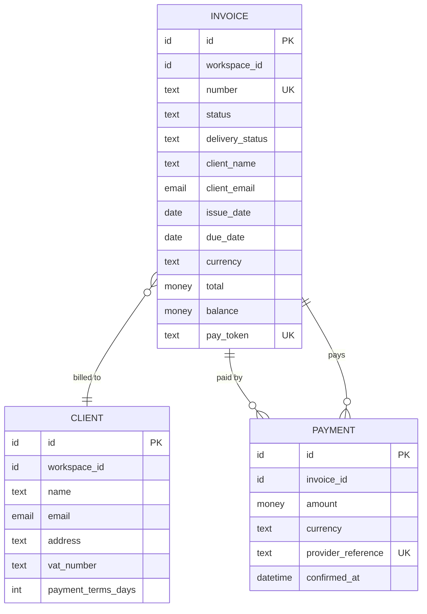

<!-- Generated by pds (er). Do not edit: change the records and regenerate. -->

# Entity relationships: Ledgerly

## Invoice

`ENT-invoice` · specified · personal data · money · confidential

| Attribute | Type | Required | Unique | Personal | Note |
| --- | --- | --- | --- | --- | --- |
| id | id | yes | yes |  |  |
| workspace_id | id | yes |  |  |  |
| number | text | yes | yes |  | Empty while a draft; INV- and four digits once sent |
| status | text | yes |  |  | One of the states of the invoice lifecycle |
| delivery_status | text | yes |  |  | Queued and then delivered or undelivered as the email provider reports |
| client_name | text | yes |  | yes | Copied from the client when sent |
| client_email | email | yes |  | yes | Copied from the client when sent |
| issue_date | date |  |  |  | Set when sent |
| due_date | date | yes |  |  |  |
| currency | text | yes |  |  |  |
| total | money | yes |  |  | Computed from the lines |
| balance | money | yes |  |  | Total minus confirmed payments |
| pay_token | text | yes | yes |  | Secret; it is the private link |

## Client

`ENT-client` · specified · personal data · confidential

| Attribute | Type | Required | Unique | Personal | Note |
| --- | --- | --- | --- | --- | --- |
| id | id | yes | yes |  |  |
| workspace_id | id | yes |  |  |  |
| name | text | yes |  | yes | Company or person's name |
| email | email | yes |  | yes | Where invoices are sent |
| address | text |  |  | yes | Needed on the invoice for EU VAT |
| vat_number | text |  |  |  | Shown on the invoice when present |
| payment_terms_days | int |  |  |  | Default days between sending and the due date |

## Payment

`ENT-payment` · specified · money · confidential

| Attribute | Type | Required | Unique | Personal | Note |
| --- | --- | --- | --- | --- | --- |
| id | id | yes | yes |  |  |
| invoice_id | id | yes |  |  |  |
| amount | money | yes |  |  |  |
| currency | text | yes |  |  |  |
| provider_reference | text | yes | yes |  | The provider's identifier for the charge |
| confirmed_at | datetime | yes |  |  |  |
