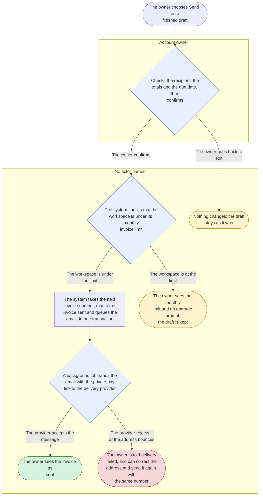
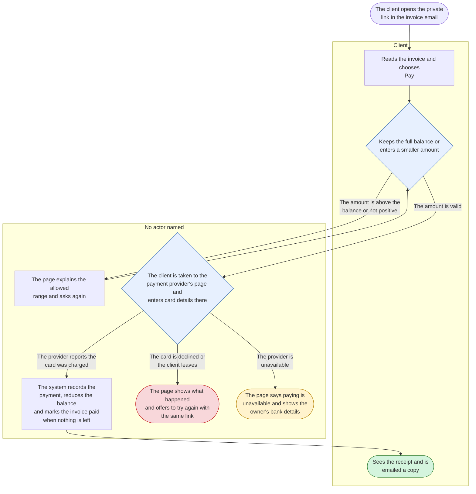

<!-- Generated by pds (flow). Do not edit: change the records and regenerate. -->

# Flow diagram: Ledgerly

## Send an invoice

`FLW-send-invoice` · verifiable (claims specified) · From the owner confirming a finished draft to the client's email being handed to the provider.

| Step | Actor | What happens | Where | Uses | Data | Emits | Then |
| --- | --- | --- | --- | --- | --- | --- | --- |
| `review` | Account owner | Checks the recipient, the totals and the due date, then confirms | Invoice review | How an invoice total is calculated |  |  | decide: The owner confirms / The owner goes back to edit |
| `check-limit` |  | The system checks that the workspace is under its monthly invoice limit |  |  |  |  | decide: The workspace is under the limit / The workspace is at the limit |
| `send` |  | The system takes the next invoice number, marks the invoice sent and queues the email, in one transaction |  | How an invoice number is formed | Invoice (update) | Invoice sent | → `deliver` |
| `deliver` |  | A background job hands the email with the private pay link to the delivery provider |  | Email sending |  |  | decide: The provider accepts the message / The provider rejects it or the address bounces |
| `done` |  | The owner sees the invoice as sent |  |  |  |  | end: success |
| `undelivered` |  | The owner is told delivery failed, and can correct the address and send it again with the same number |  |  |  |  | end: failure |
| `blocked` |  | The owner sees the monthly limit and an upgrade prompt; the draft is kept |  |  |  |  | end: abort |
| `cancelled` |  | Nothing changes; the draft stays as it was |  |  |  |  | end: abort |

## Pay an invoice online

`FLW-pay-invoice` · verifiable (claims specified) · From the client opening the private link to a recorded payment and a receipt.

| Step | Actor | What happens | Where | Uses | Data | Emits | Then |
| --- | --- | --- | --- | --- | --- | --- | --- |
| `view` | Client | Reads the invoice and chooses Pay | Pay page |  | Invoice (read) |  | → `choose-amount` |
| `choose-amount` | Client | Keeps the full balance or enters a smaller amount | Pay page | A payment is positive and no more than the balance |  |  | decide: The amount is valid / The amount is above the balance or not positive |
| `invalid-amount` |  | The page explains the allowed range and asks again |  |  |  |  | → `choose-amount` |
| `pay` |  | The client is taken to the payment provider's page and enters card details there |  | Payment provider hosted checkout |  |  | decide: The provider reports the card was charged / The card is declined or the client leaves / The provider is unavailable |
| `record` |  | The system records the payment, reduces the balance and marks the invoice paid when nothing is left |  |  | Payment (create), Invoice (update) | Payment received, Invoice paid | → `receipt` |
| `receipt` | Client | Sees the receipt and is emailed a copy | Pay page |  |  |  | end: success |
| `declined` |  | The page shows what happened and offers to try again with the same link |  |  |  |  | end: failure |
| `provider-down` |  | The page says paying is unavailable and shows the owner's bank details |  |  |  |  | end: abort |
