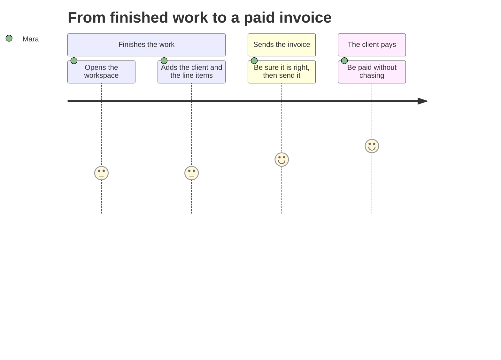

<!-- Generated by pds (journey). Do not edit: change the records and regenerate. -->

# Journey: From finished work to a paid invoice

`JRN-first-invoice` · specified · outcome: The first invoice is sent in minutes and paid in days, with no chasing.

| Stage | Goal | Touchpoints | Flows | Feeling | Pain | Opportunity |
| --- | --- | --- | --- | --- | --- | --- |
| Finishes the work | Get ready to invoice | Ledgerly web app |  | 3 | Rebuilding the same invoice by hand every month | Start from the previous invoice for the same client |
| Sends the invoice | Be sure it is right, then send it | Invoice review, Invoice email | Send an invoice | 4 | Fear of sending the wrong total or to the wrong person | A review screen that shows both plainly |
| The client pays | Be paid without chasing | Pay page, Payment received email | Pay an invoice online | 5 | Not knowing whether the client opened the email | Say when the invoice was opened |
