<!-- Generated by pds (product-map). Do not edit: change the records and regenerate. -->

# Product map: Ledgerly

PROD = zoom 0, DOM = zoom 1, CAP = zoom 2, FEAT = zoom 3, everything anchored on a feature = zoom 4. The colour is the maturity the definition supports, not the one claimed.

```mermaid
flowchart TD
  n_PROD_ledgerly["Ledgerly<br/>PROD · specified"]:::specified
  n_DOM_workspaces_and_teams["Workspaces and teams<br/>DOM · stub"]:::stub
  n_CAP_workspace_settings["Workspace settings and<br/>branding<br/>CAP · stub"]:::stub
  n_CAP_workspace_lifecycle["Creating, switching and<br/>closing workspaces<br/>CAP · stub"]:::stub
  n_CAP_tenant_isolation["Tenant isolation and<br/>data boundaries<br/>CAP · stub"]:::stub
  n_CAP_membership["Inviting and managing<br/>members<br/>CAP · stub"]:::stub
  n_DOM_trust_and_compliance["Trust, privacy and<br/>compliance<br/>DOM · stub"]:::stub
  n_CAP_security_controls["Security controls and<br/>incident response<br/>CAP · stub"]:::stub
  n_CAP_data_subject_rights["Data export and deletion<br/>requests<br/>CAP · stub"]:::stub
  n_CAP_data_retention["Data retention and<br/>deletion schedules<br/>CAP · stub"]:::stub
  n_CAP_consent_and_legal["Consent, terms and<br/>privacy notices<br/>CAP · stub"]:::stub
  n_DOM_platform_and_operations["Platform and operations<br/>DOM · stub"]:::stub
  n_CAP_product_analytics["Product analytics<br/>instrumentation<br/>CAP · stub"]:::stub
  n_CAP_performance_and_scale["Performance and capacity<br/>CAP · stub"]:::stub
  n_CAP_observability["Monitoring, logging and<br/>alerting<br/>CAP · stub"]:::stub
  n_CAP_environments_and_releases["Environments, releases<br/>and rollback<br/>CAP · stub"]:::stub
  n_CAP_backup_and_recovery["Backup and disaster<br/>recovery<br/>CAP · stub"]:::stub
  n_DOM_onboarding_and_activation["Onboarding and<br/>activation<br/>DOM · stub"]:::stub
  n_CAP_sample_data["Sample data and<br/>templates<br/>CAP · stub"]:::stub
  n_CAP_first_run["First-run setup and<br/>guided start<br/>CAP · stub"]:::stub
  n_CAP_activation_nudges["Checklists and<br/>activation prompts<br/>CAP · stub"]:::stub
  n_DOM_notifications_and_messaging["Notifications and<br/>messaging<br/>DOM · stub"]:::stub
  n_CAP_transactional_email["Transactional email<br/>CAP · stub"]:::stub
  n_CAP_messaging_preferences["Notification preferences<br/>and consent<br/>CAP · stub"]:::stub
  n_CAP_lifecycle_campaigns["Lifecycle and<br/>product-update messages<br/>CAP · stub"]:::stub
  n_CAP_in_app_notifications["In-app notifications<br/>CAP · stub"]:::stub
  n_DOM_marketing_and_acquisition["Marketing and<br/>acquisition<br/>DOM · stub"]:::stub
  n_CAP_pricing_page["Pricing and plan<br/>comparison<br/>CAP · stub"]:::stub
  n_CAP_marketing_site["Marketing site and<br/>content<br/>CAP · stub"]:::stub
  n_CAP_lead_capture["Lead capture and demo<br/>requests<br/>CAP · stub"]:::stub
  n_CAP_attribution["Attribution and<br/>referrals<br/>CAP · stub"]:::stub
  n_DOM_invoicing["Invoicing and clients<br/>DOM · specified"]:::specified
  n_CAP_invoicing["Invoicing<br/>CAP · specified"]:::specified
  n_FEAT_send_invoice["Send an invoice<br/>FEAT · verifiable"]:::verifiable
  n_FEAT_draft_invoice["Draft an invoice<br/>FEAT · outlined"]:::outlined
  n_CAP_collect_payments["Collect payments<br/>CAP · specified"]:::specified
  n_FEAT_pay_invoice_online["Pay an invoice online<br/>FEAT · verifiable"]:::verifiable
  n_DOM_integrations_and_api["Integrations and API<br/>DOM · stub"]:::stub
  n_CAP_webhooks["Outbound webhooks<br/>CAP · stub"]:::stub
  n_CAP_third_party_connections["Connections to other<br/>products<br/>CAP · stub"]:::stub
  n_CAP_import_export["Data import and export<br/>CAP · stub"]:::stub
  n_DOM_insights_and_reporting["Insights and reporting<br/>DOM · stub"]:::stub
  n_CAP_scheduled_reports["Scheduled and shared<br/>reports<br/>CAP · stub"]:::stub
  n_CAP_dashboards["Dashboards and reports<br/>CAP · stub"]:::stub
  n_DOM_identity_and_access["Identity and access<br/>DOM · stub"]:::stub
  n_CAP_single_sign_on["Single sign-on<br/>CAP · stub"]:::stub
  n_CAP_sign_up["Sign-up and account<br/>creation<br/>CAP · stub"]:::stub
  n_CAP_roles_and_permissions["Roles and permissions<br/>CAP · stub"]:::stub
  n_CAP_multi_factor["Multi-factor<br/>authentication<br/>CAP · stub"]:::stub
  n_CAP_credential_recovery["Password and credential<br/>recovery<br/>CAP · stub"]:::stub
  n_CAP_authentication["Sign-in, sessions and<br/>sign-out<br/>CAP · stub"]:::stub
  n_CAP_account_profile["Personal profile and<br/>preferences<br/>CAP · stub"]:::stub
  n_DOM_billing_and_plans["Billing and plans<br/>DOM · stub"]:::stub
  n_CAP_usage_metering["Usage metering and<br/>limits<br/>CAP · stub"]:::stub
  n_CAP_tax_and_currency["Tax, VAT and currency<br/>CAP · stub"]:::stub
  n_CAP_subscription_receipts["Subscription receipts<br/>CAP · stub"]:::stub
  n_CAP_subscription_lifecycle["Subscription: trial,<br/>start, change, cancel,<br/>renew<br/>CAP · stub"]:::stub
  n_FEAT_upgrade_plan["Upgrade to the Team plan<br/>FEAT · outlined"]:::outlined
  n_CAP_refunds_and_credits["Refunds, credits and<br/>disputes<br/>CAP · stub"]:::stub
  n_CAP_plan_catalogue["Plans, pricing and<br/>entitlements<br/>CAP · stub"]:::stub
  n_CAP_payment_methods["Payment methods and<br/>checkout<br/>CAP · stub"]:::stub
  n_CAP_failed_payments["Failed payments and<br/>dunning<br/>CAP · stub"]:::stub
  n_PROD_ledgerly --> n_DOM_workspaces_and_teams
  n_DOM_workspaces_and_teams --> n_CAP_workspace_settings
  n_DOM_workspaces_and_teams --> n_CAP_workspace_lifecycle
  n_DOM_workspaces_and_teams --> n_CAP_tenant_isolation
  n_DOM_workspaces_and_teams --> n_CAP_membership
  n_PROD_ledgerly --> n_DOM_trust_and_compliance
  n_DOM_trust_and_compliance --> n_CAP_security_controls
  n_DOM_trust_and_compliance --> n_CAP_data_subject_rights
  n_DOM_trust_and_compliance --> n_CAP_data_retention
  n_DOM_trust_and_compliance --> n_CAP_consent_and_legal
  n_PROD_ledgerly --> n_DOM_platform_and_operations
  n_DOM_platform_and_operations --> n_CAP_product_analytics
  n_DOM_platform_and_operations --> n_CAP_performance_and_scale
  n_DOM_platform_and_operations --> n_CAP_observability
  n_DOM_platform_and_operations --> n_CAP_environments_and_releases
  n_DOM_platform_and_operations --> n_CAP_backup_and_recovery
  n_PROD_ledgerly --> n_DOM_onboarding_and_activation
  n_DOM_onboarding_and_activation --> n_CAP_sample_data
  n_DOM_onboarding_and_activation --> n_CAP_first_run
  n_DOM_onboarding_and_activation --> n_CAP_activation_nudges
  n_PROD_ledgerly --> n_DOM_notifications_and_messaging
  n_DOM_notifications_and_messaging --> n_CAP_transactional_email
  n_DOM_notifications_and_messaging --> n_CAP_messaging_preferences
  n_DOM_notifications_and_messaging --> n_CAP_lifecycle_campaigns
  n_DOM_notifications_and_messaging --> n_CAP_in_app_notifications
  n_PROD_ledgerly --> n_DOM_marketing_and_acquisition
  n_DOM_marketing_and_acquisition --> n_CAP_pricing_page
  n_DOM_marketing_and_acquisition --> n_CAP_marketing_site
  n_DOM_marketing_and_acquisition --> n_CAP_lead_capture
  n_DOM_marketing_and_acquisition --> n_CAP_attribution
  n_PROD_ledgerly --> n_DOM_invoicing
  n_DOM_invoicing --> n_CAP_invoicing
  n_CAP_invoicing --> n_FEAT_send_invoice
  n_CAP_invoicing --> n_FEAT_draft_invoice
  n_DOM_invoicing --> n_CAP_collect_payments
  n_CAP_collect_payments --> n_FEAT_pay_invoice_online
  n_PROD_ledgerly --> n_DOM_integrations_and_api
  n_DOM_integrations_and_api --> n_CAP_webhooks
  n_DOM_integrations_and_api --> n_CAP_third_party_connections
  n_DOM_integrations_and_api --> n_CAP_import_export
  n_PROD_ledgerly --> n_DOM_insights_and_reporting
  n_DOM_insights_and_reporting --> n_CAP_scheduled_reports
  n_DOM_insights_and_reporting --> n_CAP_dashboards
  n_PROD_ledgerly --> n_DOM_identity_and_access
  n_DOM_identity_and_access --> n_CAP_single_sign_on
  n_DOM_identity_and_access --> n_CAP_sign_up
  n_DOM_identity_and_access --> n_CAP_roles_and_permissions
  n_DOM_identity_and_access --> n_CAP_multi_factor
  n_DOM_identity_and_access --> n_CAP_credential_recovery
  n_DOM_identity_and_access --> n_CAP_authentication
  n_DOM_identity_and_access --> n_CAP_account_profile
  n_PROD_ledgerly --> n_DOM_billing_and_plans
  n_DOM_billing_and_plans --> n_CAP_usage_metering
  n_DOM_billing_and_plans --> n_CAP_tax_and_currency
  n_DOM_billing_and_plans --> n_CAP_subscription_receipts
  n_DOM_billing_and_plans --> n_CAP_subscription_lifecycle
  n_CAP_subscription_lifecycle --> n_FEAT_upgrade_plan
  n_DOM_billing_and_plans --> n_CAP_refunds_and_credits
  n_DOM_billing_and_plans --> n_CAP_plan_catalogue
  n_DOM_billing_and_plans --> n_CAP_payment_methods
  n_DOM_billing_and_plans --> n_CAP_failed_payments
  classDef stub fill:#eeeeee,stroke:#9e9e9e,color:#333;
  classDef outlined fill:#d6e9ff,stroke:#5b9bd5,color:#123;
  classDef specified fill:#d4f0d4,stroke:#5aa65a,color:#123;
  classDef verifiable fill:#9fd89f,stroke:#2e7d32,color:#012;
```

## Outline

- [`PROD-ledgerly`](../definition/intent/PROD-ledgerly.md) Ledgerly · **specified** · 4 actors, 1 assumption, 4 decisions, 1 entitlement, 1 evidence, 2 external systems, 4 metrics, 5 objectives, 6 obligations, 1 opportunity, 3 permissions, 1 persona, 3 plans, 7 open questions, 1 release, 4 roles, 2 customer segments, 4 surfaces, 1 tenancy model, 7 glossary terms
  - [`DOM-billing-and-plans`](../definition/structure/DOM-billing-and-plans.md) Billing and plans · **stub** · tier 1
    - [`CAP-failed-payments`](../definition/structure/CAP-failed-payments.md) Failed payments and dunning · **stub**
    - [`CAP-payment-methods`](../definition/structure/CAP-payment-methods.md) Payment methods and checkout · **stub**
    - [`CAP-plan-catalogue`](../definition/structure/CAP-plan-catalogue.md) Plans, pricing and entitlements · **stub**
    - [`CAP-refunds-and-credits`](../definition/structure/CAP-refunds-and-credits.md) Refunds, credits and disputes · **stub**
    - [`CAP-subscription-lifecycle`](../definition/structure/CAP-subscription-lifecycle.md) Subscription: trial, start, change, cancel, renew · **stub**
      - [`FEAT-upgrade-plan`](../definition/structure/FEAT-upgrade-plan.md) Upgrade to the Team plan · **outlined** · tier 2
    - [`CAP-subscription-receipts`](../definition/structure/CAP-subscription-receipts.md) Subscription receipts · **stub**
    - [`CAP-tax-and-currency`](../definition/structure/CAP-tax-and-currency.md) Tax, VAT and currency · **stub**
    - [`CAP-usage-metering`](../definition/structure/CAP-usage-metering.md) Usage metering and limits · **stub**
  - [`DOM-identity-and-access`](../definition/structure/DOM-identity-and-access.md) Identity and access · **stub** · tier 1
    - [`CAP-account-profile`](../definition/structure/CAP-account-profile.md) Personal profile and preferences · **stub**
    - [`CAP-authentication`](../definition/structure/CAP-authentication.md) Sign-in, sessions and sign-out · **stub**
    - [`CAP-credential-recovery`](../definition/structure/CAP-credential-recovery.md) Password and credential recovery · **stub**
    - [`CAP-multi-factor`](../definition/structure/CAP-multi-factor.md) Multi-factor authentication · **stub**
    - [`CAP-roles-and-permissions`](../definition/structure/CAP-roles-and-permissions.md) Roles and permissions · **stub**
    - [`CAP-sign-up`](../definition/structure/CAP-sign-up.md) Sign-up and account creation · **stub**
    - [`CAP-single-sign-on`](../definition/structure/CAP-single-sign-on.md) Single sign-on · **stub**
  - [`DOM-insights-and-reporting`](../definition/structure/DOM-insights-and-reporting.md) Insights and reporting · **stub**
    - [`CAP-dashboards`](../definition/structure/CAP-dashboards.md) Dashboards and reports · **stub**
    - [`CAP-scheduled-reports`](../definition/structure/CAP-scheduled-reports.md) Scheduled and shared reports · **stub**
  - [`DOM-integrations-and-api`](../definition/structure/DOM-integrations-and-api.md) Integrations and API · **stub**
    - [`CAP-import-export`](../definition/structure/CAP-import-export.md) Data import and export · **stub**
    - [`CAP-third-party-connections`](../definition/structure/CAP-third-party-connections.md) Connections to other products · **stub**
    - [`CAP-webhooks`](../definition/structure/CAP-webhooks.md) Outbound webhooks · **stub**
  - [`DOM-invoicing`](../definition/structure/DOM-invoicing.md) Invoicing and clients · **specified (claims outlined)** · tier 1 · 1 journey
    - [`CAP-collect-payments`](../definition/structure/CAP-collect-payments.md) Collect payments · **specified** · tier 1 · 2 decisions, 1 entity, 2 events, 1 integration, 1 permission, 1 open question, 1 requirement, 1 business rule, 1 test
      - [`FEAT-pay-invoice-online`](../definition/structure/FEAT-pay-invoice-online.md) Pay an invoice online · **verifiable (claims specified)** · tier 1 · 1 flow, 1 message, 1 open question, 6 requirements, 1 risk, 1 screen, 4 tests
    - [`CAP-invoicing`](../definition/structure/CAP-invoicing.md) Invoicing · **specified** · tier 1 · 1 decision, 2 entitys, 1 event, 1 integration, 1 permission, 1 open question, 1 requirement, 2 business rules, 1 state machine, 4 tests, 1 use case
      - [`FEAT-draft-invoice`](../definition/structure/FEAT-draft-invoice.md) Draft an invoice · **outlined** · tier 1
      - [`FEAT-send-invoice`](../definition/structure/FEAT-send-invoice.md) Send an invoice · **verifiable (claims specified)** · tier 1 · 1 flow, 1 metric, 1 message, 3 requirements, 2 risks, 1 business rule, 1 screen, 3 tests
  - [`DOM-marketing-and-acquisition`](../definition/structure/DOM-marketing-and-acquisition.md) Marketing and acquisition · **stub**
    - [`CAP-attribution`](../definition/structure/CAP-attribution.md) Attribution and referrals · **stub**
    - [`CAP-lead-capture`](../definition/structure/CAP-lead-capture.md) Lead capture and demo requests · **stub**
    - [`CAP-marketing-site`](../definition/structure/CAP-marketing-site.md) Marketing site and content · **stub**
    - [`CAP-pricing-page`](../definition/structure/CAP-pricing-page.md) Pricing and plan comparison · **stub**
  - [`DOM-notifications-and-messaging`](../definition/structure/DOM-notifications-and-messaging.md) Notifications and messaging · **stub**
    - [`CAP-in-app-notifications`](../definition/structure/CAP-in-app-notifications.md) In-app notifications · **stub**
    - [`CAP-lifecycle-campaigns`](../definition/structure/CAP-lifecycle-campaigns.md) Lifecycle and product-update messages · **stub**
    - [`CAP-messaging-preferences`](../definition/structure/CAP-messaging-preferences.md) Notification preferences and consent · **stub**
    - [`CAP-transactional-email`](../definition/structure/CAP-transactional-email.md) Transactional email · **stub**
  - [`DOM-onboarding-and-activation`](../definition/structure/DOM-onboarding-and-activation.md) Onboarding and activation · **stub**
    - [`CAP-activation-nudges`](../definition/structure/CAP-activation-nudges.md) Checklists and activation prompts · **stub**
    - [`CAP-first-run`](../definition/structure/CAP-first-run.md) First-run setup and guided start · **stub**
    - [`CAP-sample-data`](../definition/structure/CAP-sample-data.md) Sample data and templates · **stub**
  - [`DOM-platform-and-operations`](../definition/structure/DOM-platform-and-operations.md) Platform and operations · **stub**
    - [`CAP-backup-and-recovery`](../definition/structure/CAP-backup-and-recovery.md) Backup and disaster recovery · **stub**
    - [`CAP-environments-and-releases`](../definition/structure/CAP-environments-and-releases.md) Environments, releases and rollback · **stub**
    - [`CAP-observability`](../definition/structure/CAP-observability.md) Monitoring, logging and alerting · **stub**
    - [`CAP-performance-and-scale`](../definition/structure/CAP-performance-and-scale.md) Performance and capacity · **stub**
    - [`CAP-product-analytics`](../definition/structure/CAP-product-analytics.md) Product analytics instrumentation · **stub**
  - [`DOM-trust-and-compliance`](../definition/structure/DOM-trust-and-compliance.md) Trust, privacy and compliance · **stub** · tier 1
    - [`CAP-consent-and-legal`](../definition/structure/CAP-consent-and-legal.md) Consent, terms and privacy notices · **stub**
    - [`CAP-data-retention`](../definition/structure/CAP-data-retention.md) Data retention and deletion schedules · **stub**
    - [`CAP-data-subject-rights`](../definition/structure/CAP-data-subject-rights.md) Data export and deletion requests · **stub**
    - [`CAP-security-controls`](../definition/structure/CAP-security-controls.md) Security controls and incident response · **stub**
  - [`DOM-workspaces-and-teams`](../definition/structure/DOM-workspaces-and-teams.md) Workspaces and teams · **stub** · tier 1 · 1 requirement
    - [`CAP-membership`](../definition/structure/CAP-membership.md) Inviting and managing members · **stub**
    - [`CAP-tenant-isolation`](../definition/structure/CAP-tenant-isolation.md) Tenant isolation and data boundaries · **stub**
    - [`CAP-workspace-lifecycle`](../definition/structure/CAP-workspace-lifecycle.md) Creating, switching and closing workspaces · **stub**
    - [`CAP-workspace-settings`](../definition/structure/CAP-workspace-settings.md) Workspace settings and branding · **stub**
