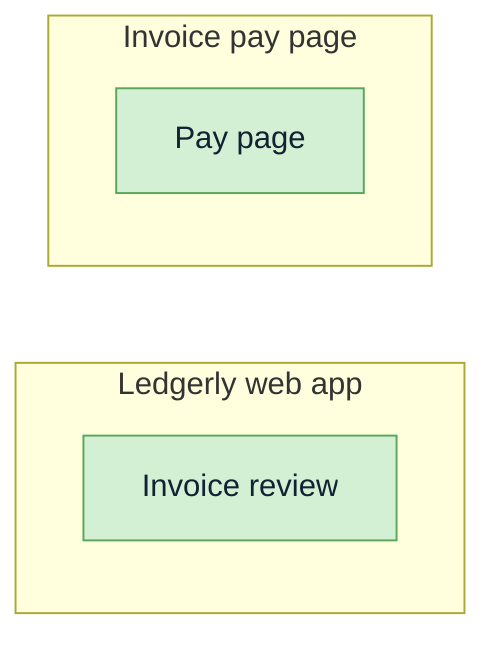

<!-- Generated by pds (screens). Do not edit: change the records and regenerate. -->

# Screen map: Ledgerly

Solid arrows are navigation stated on the screen; dotted arrows are movement implied by a flow.
