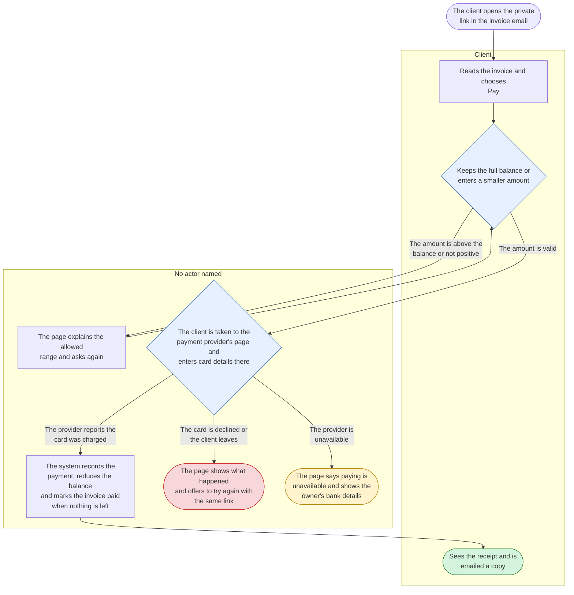
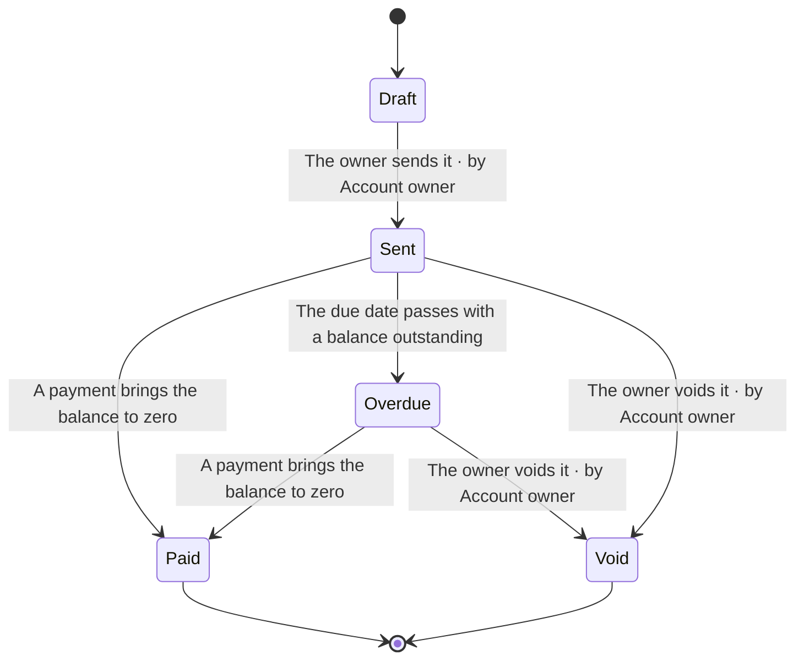
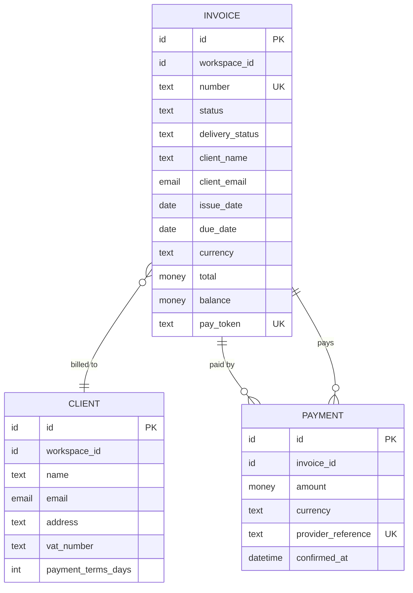

<!-- Generated by pds (spec CAP-collect-payments). Do not edit: change the records and regenerate. -->

# Capability specification: Collect payments

> Let a client pay an invoice online and show the owner the result without chasing.

## Purpose and outcome

Closes the loop the product promises: sent today, paid this week. Success is the median time from sending to paid falling below the 38 days people report today ([`MET-days-to-paid`](../../definition/operations/MET-days-to-paid.md)).

## Features

| Feature | Kind | Tier | Maturity |
| --- | --- | --- | --- |
| [`FEAT-pay-invoice-online`](../../definition/structure/FEAT-pay-invoice-online.md) Pay an invoice online | user_facing | 1 | verifiable (claims specified) |

## Feature specification: Pay an invoice online

> A client opens the private link, sees what is owed and pays by card; the invoice turns paid by itself.

|  |  |
| --- | --- |
| Id | `FEAT-pay-invoice-online` |
| Belongs to | Ledgerly › Invoicing and clients › Collect payments |
| Kind | user_facing |
| Tier | 1 |
| Owner | Sam Ortiz |
| Maturity | verifiable supported · specified claimed |
| Approval | draft |
| Reviewed | 2026-10-22 |

### 1. Purpose and value

Removes the step that makes invoices late: the client needing to find bank details and remember to transfer. One link, one payment, one receipt. Its worth depends on [`ASM-clients-pay-online`](../../definition/change/ASM-clients-pay-online.md).

Out of scope: bank transfers, refunds, and clients managing an account.

**Serves:** [`OBJ-paid-faster`](../../definition/intent/OBJ-paid-faster.md) Customers get paid sooner; [`OPP-late-payment`](../../definition/intent/OPP-late-payment.md) Freelancers wait weeks for money they have already earned

**For:** Client, Account owner

### 2. Entry and access

Reached from the link in the invoice email ([`MSG-invoice-email`](../../definition/experience/MSG-invoice-email.md)). The invoice must be sent and not void; a paid invoice shows its receipt instead of payment options. No sign-in. The first thing the client sees is the invoice they are about to pay ([`SCR-pay-page`](../../definition/experience/SCR-pay-page.md)).

**Permissions needed**

| Permission | Roles that hold it |
| --- | --- |
| [`PERM-pay-invoice`](../../definition/actors/PERM-pay-invoice.md) Pay an invoice | Invoice recipient |

**Plan gating**

_Not gated by plan._

### 3. Flows

#### Pay an invoice online

From the client opening the private link to a recorded payment and a receipt.

The invoice is marked paid only when the provider confirms the charge, never when the client returns to the page ([`REQ-payment-confirmation`](../../definition/behaviour/REQ-payment-confirmation.md)). The page can be re-entered at any point, so every step starts from the invoice's current state, not from the page's history.

### 4. Screens and messages

**Screens**

| Screen | Kind | Surface | States |
| --- | --- | --- | --- |
| [`SCR-pay-page`](../../definition/experience/SCR-pay-page.md) Pay page | page | Invoice pay page | loading, ready, paid, void, empty, error |

**Messages**

| Message | Channel | Class | Sent when | To |
| --- | --- | --- | --- | --- |
| [`MSG-payment-received`](../../definition/experience/MSG-payment-received.md) Payment received email | email | transactional | Payment received | Account owner |

### 5. Business rules

#### A payment is positive and no more than the balance

`RULE-payment-covers-balance` · shared, lives under Collect payments

A payment amount must be greater than zero and no more than the invoice's outstanding balance when the payment is started.

| Case | Given | Then |
| --- | --- | --- |
| positive | A balance of 308.55 and a payment of 308.55 | The payment is accepted and the invoice becomes paid |
| positive | A balance of 308.55 and a payment of 100.00 | The payment is accepted, the balance becomes 208.55 and the invoice stays sent |
| edge | A balance of 0.01 and a payment of 0.01 | The payment is accepted, as the smallest payable amount |
| negative | A balance of 308.55 and a payment of 400.00 | The payment is refused before the client leaves for the provider, and the allowed range is shown |

### 6. State

#### Invoice lifecycle

### 7. Data

| Entity | Operations | Personal data | Classification | Retention |
| --- | --- | --- | --- | --- |
| [`ENT-invoice`](../../definition/information/ENT-invoice.md) Invoice | read, update | yes | confidential | Seven years from the end of the financial year of the invoice, as tax law requires |
| [`ENT-payment`](../../definition/information/ENT-payment.md) Payment | create |  | confidential | Seven years, with the invoice it belongs to |

### 8. Events and integrations

| Direction | Event | By |
| --- | --- | --- |
| emits | [`EVT-payment-received`](../../definition/information/EVT-payment-received.md) Payment received | [`FEAT-pay-invoice-online`](../../definition/structure/FEAT-pay-invoice-online.md), [`FLW-pay-invoice`](../../definition/experience/FLW-pay-invoice.md) |
| emits | [`EVT-invoice-paid`](../../definition/information/EVT-invoice-paid.md) Invoice paid | [`FEAT-pay-invoice-online`](../../definition/structure/FEAT-pay-invoice-online.md), [`FLW-pay-invoice`](../../definition/experience/FLW-pay-invoice.md) |
| consumes | [`EVT-payment-received`](../../definition/information/EVT-payment-received.md) Payment received | [`MSG-payment-received`](../../definition/experience/MSG-payment-received.md) |

**Depends on**

| Element | Type |
| --- | --- |
| [`INT-payment-provider-checkout`](../../definition/information/INT-payment-provider-checkout.md) Payment provider hosted checkout | INT |

### 9. Requirements

| Requirement | Kind | Priority | Verification | Statement |
| --- | --- | --- | --- | --- |
| [`REQ-pay-link-outlives-plan`](../../definition/behaviour/REQ-pay-link-outlives-plan.md) | functional | must | test | While an invoice is sent and unpaid, the system shall keep its pay link working whatever the state of the workspace's plan. |
| [`REQ-pay-link-unguessable`](../../definition/behaviour/REQ-pay-link-unguessable.md) | constraint | must | inspection | The system shall generate each pay link token from at least 128 bits of randomness. |
| [`REQ-pay-page-load-time`](../../definition/behaviour/REQ-pay-page-load-time.md) | quality: performance | should | test | When a client opens the pay page, the system shall show the invoice within 2 seconds in at least 95% of views on a mobile connection. |
| [`REQ-payment-confirmation`](../../definition/behaviour/REQ-payment-confirmation.md) | functional | must | test | The system shall mark an invoice paid only after the payment provider confirms the charge. |
| [`REQ-payment-provider-fallback`](../../definition/behaviour/REQ-payment-provider-fallback.md) | functional | should | test | If the payment provider is unavailable, the pay page shall show the owner's bank details and a notice that paying online is unavailable. |
| [`REQ-unmatched-confirmation-alert`](../../definition/behaviour/REQ-unmatched-confirmation-alert.md) | functional | must | test | If a payment confirmation arrives for an invoice that does not exist or cannot accept payment, the system shall alert the person on call within 5 minutes without applying it. |

### 10. Concerns

| Probe | Disposition | Detail |
| --- | --- | --- |
| Failure paths | addressed | [`FLW-pay-invoice`](../../definition/experience/FLW-pay-invoice.md) |
| First use and empty state | addressed | [`SCR-pay-page`](../../definition/experience/SCR-pay-page.md) |
| Concurrency and duplicates | deferred | Repeated confirmations are safe, but two payments started together can exceed the balance. (until [`QST-overpayment`](../../definition/change/QST-overpayment.md)) |
| Deletion and retention | na | A payment is never deleted or edited once recorded and stays with its invoice for the retention period; refunds are out of scope. |
| Audit trail | addressed | [`EVT-payment-received`](../../definition/information/EVT-payment-received.md) |
| Limits and quotas | addressed | [`RULE-payment-covers-balance`](../../definition/behaviour/RULE-payment-covers-balance.md) |
| Lists, search and bulk actions | na | A client sees one invoice on one page; there is nothing to list, search or act on in bulk. |
| Getting data in and out | na | A client has no account and no data of their own to bring in or take out. |
| Accessibility | addressed | [`SCR-pay-page`](../../definition/experience/SCR-pay-page.md), [`OBL-accessibility`](../../definition/assurance/OBL-accessibility.md) |
| Localisation | deferred | The first release is English only; amounts and dates follow the invoice's format. (until 2027-06-30) |
| Performance and volume | addressed | [`REQ-pay-page-load-time`](../../definition/behaviour/REQ-pay-page-load-time.md) |
| Observability | addressed | [`REQ-unmatched-confirmation-alert`](../../definition/behaviour/REQ-unmatched-confirmation-alert.md) |
| Rollout and migration | addressed | [`RLS-first-release`](../../definition/change/RLS-first-release.md) |
| Product analytics | addressed | [`MET-days-to-paid`](../../definition/operations/MET-days-to-paid.md) |
| Abuse and misuse | addressed | [`REQ-pay-link-unguessable`](../../definition/behaviour/REQ-pay-link-unguessable.md) |
| Personal data | deferred | How owners answer a client's request to see, correct or erase their data is not decided. (until [`QST-client-data-requests`](../../definition/change/QST-client-data-requests.md)) |
| Tenant isolation | addressed | [`REQ-workspace-data-isolation`](../../definition/behaviour/REQ-workspace-data-isolation.md), [`TST-workspace-isolation`](../../definition/assurance/TST-workspace-isolation.md) |
| Tenant states | addressed | [`REQ-pay-link-outlives-plan`](../../definition/behaviour/REQ-pay-link-outlives-plan.md) |
| Plan gating | na | Paying is available on every plan; a client is never gated by the owner's plan. |
| Billing impact | deferred | Refunds, chargebacks and disputes are not handled in the first release. (until [`QST-refunds-and-disputes`](../../definition/change/QST-refunds-and-disputes.md)) |
| Usage metering | na | Payments are not counted against any limit and Ledgerly charges no fee per payment. |
| When a dependency fails | addressed | [`FLW-pay-invoice`](../../definition/experience/FLW-pay-invoice.md), [`REQ-payment-provider-fallback`](../../definition/behaviour/REQ-payment-provider-fallback.md) |
| Event delivery | addressed | [`EVT-payment-received`](../../definition/information/EVT-payment-received.md) |
| Message preferences and delivery | addressed | [`MSG-payment-received`](../../definition/experience/MSG-payment-received.md) |

### 11. Verification

| Test | Kind | Level | Automation | Result | Verifies |
| --- | --- | --- | --- | --- | --- |
| [`TST-pay-online`](../../definition/assurance/TST-pay-online.md) A client pays an invoice from the email link | scenario | e2e | planned | unknown | [`FEAT-pay-invoice-online`](../../definition/structure/FEAT-pay-invoice-online.md), [`FLW-pay-invoice`](../../definition/experience/FLW-pay-invoice.md), [`REQ-payment-confirmation`](../../definition/behaviour/REQ-payment-confirmation.md), [`REQ-pay-link-outlives-plan`](../../definition/behaviour/REQ-pay-link-outlives-plan.md), [`RULE-payment-covers-balance`](../../definition/behaviour/RULE-payment-covers-balance.md), [`SCR-pay-page`](../../definition/experience/SCR-pay-page.md) |
| [`TST-pay-page-load-time`](../../definition/assurance/TST-pay-page-load-time.md) The pay page shows the invoice within 2 seconds | performance | monitoring | planned | unknown | [`REQ-pay-page-load-time`](../../definition/behaviour/REQ-pay-page-load-time.md) |
| [`TST-pay-provider-down`](../../definition/assurance/TST-pay-provider-down.md) The pay page falls back when the provider is down | scenario | integration | planned | unknown | [`REQ-payment-provider-fallback`](../../definition/behaviour/REQ-payment-provider-fallback.md) |
| [`TST-unmatched-confirmation`](../../definition/assurance/TST-unmatched-confirmation.md) A confirmation for an unknown invoice raises an alert | scenario | integration | planned | unknown | [`REQ-unmatched-confirmation-alert`](../../definition/behaviour/REQ-unmatched-confirmation-alert.md) |

### 12. Decisions, assumptions, questions and risks

| Type | Entry | Status |
| --- | --- | --- |
| DEC | [`DEC-private-pay-link`](../../definition/change/DEC-private-pay-link.md) Clients pay through a private link, with no account | accepted |
| ASM | [`ASM-clients-pay-online`](../../definition/change/ASM-clients-pay-online.md) Clients will pay by card from the invoice email | open |
| RISK | [`RISK-payment-provider-outage`](../../definition/assurance/RISK-payment-provider-outage.md) The payment provider is unavailable | mitigating |
| QST | [`QST-client-data-requests`](../../definition/change/QST-client-data-requests.md) What happens when a client asks to see or erase their data? | open |
| QST | [`QST-overpayment`](../../definition/change/QST-overpayment.md) What if two payments for one invoice are confirmed at once? | open |
| QST | [`QST-refunds-and-disputes`](../../definition/change/QST-refunds-and-disputes.md) Who handles refunds and chargebacks? | open |

### 13. Release and maintenance

Closed beta with five workspaces before launch, to validate [`ASM-clients-pay-online`](../../definition/change/ASM-clients-pay-online.md). Monitored by payment success rate and by confirmations that arrive without a matching invoice, which must page someone. Switching it off falls back to showing bank details only. Retiring it needs a plan for payments in flight.

**Planned in:** [`RLS-first-release`](../../definition/change/RLS-first-release.md) First release

### Completeness

At the top rung.
