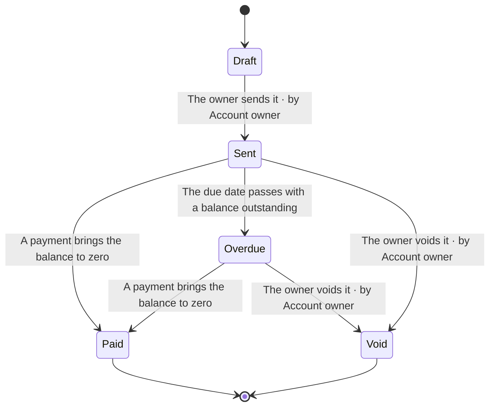
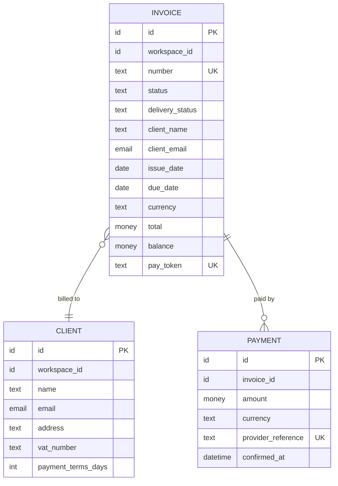

<!-- Generated by pds (spec FEAT-draft-invoice). Do not edit: change the records and regenerate. -->

# Feature specification: Draft an invoice

> Create and edit an invoice for a client, with lines, tax and a due date, until it is ready to send.

|  |  |
| --- | --- |
| Id | `FEAT-draft-invoice` |
| Belongs to | Ledgerly › Invoicing and clients › Invoicing |
| Kind | user_facing |
| Tier | 1 |
| Maturity | outlined supported · outlined claimed |
| Approval | draft |

## 1. Purpose and value

Where an invoice is made: pick or add a client, add lines, set tax and a due date, save as often as needed. A draft has no number and can be changed or deleted freely. Sending it is a separate, deliberate step ([`FEAT-send-invoice`](../../definition/structure/FEAT-send-invoice.md)).

**Serves:** [`OBJ-first-value`](../../definition/intent/OBJ-first-value.md) New customers send an invoice in their first week; [`OPP-late-payment`](../../definition/intent/OPP-late-payment.md) Freelancers wait weeks for money they have already earned

**For:** Account owner, Member

## 2. Entry and access

_Entry conditions not written yet._

**Permissions needed**

_None._

**Plan gating**

_Not gated by plan._

## 3. Flows

_No flow yet._

## 4. Screens and messages

**Screens**

_None._

**Messages**

_None._

## 5. Business rules

_No rules yet._

## 6. State

### Invoice lifecycle

## 7. Data

| Entity | Operations | Personal data | Classification | Retention |
| --- | --- | --- | --- | --- |
| [`ENT-invoice`](../../definition/information/ENT-invoice.md) Invoice | create, read, update, delete | yes | confidential | Seven years from the end of the financial year of the invoice, as tax law requires |
| [`ENT-client`](../../definition/information/ENT-client.md) Client | create, read, update | yes | confidential | Until the owner deletes the client or the workspace is closed; invoices already sent keep their own copy |

## 8. Events and integrations

_None._

**Depends on**

_None._

## 9. Requirements

_None._

## 10. Concerns

| Probe | Disposition | Detail |
| --- | --- | --- |
| Failure paths | **not answered** | What happens when it goes wrong: invalid input, a failing dependency, an interrupted action, partial completion? What does the person see, and is anything left half done? |
| Concurrency and duplicates | **not answered** | What happens if two people change the same thing at once, or the same person submits twice, or a request is retried? Is it safe to repeat? |
| Deletion and retention | **not answered** | What happens when this is deleted or archived: what happens to related data, can it be restored, and how long is it kept? |
| Audit trail | **not answered** | Is it recorded who did what and when, can that be seen by the right people, and can it be altered? |
| Limits and quotas | **not answered** | Which limits apply: size, count, rate, length? What does the person see at the limit, and what is the limit protecting? |
| Getting data in and out | **not answered** | Can people bring their data in and take it out, in which formats, and with what limits? |
| Performance and volume | **not answered** | How fast must it be, at what volume, for how many people at once? Which number would make it unacceptable? |
| Observability | **not answered** | How would you know it is broken before a customer tells you: which signals, which alerts, who responds? |
| Rollout and migration | **not answered** | How does it reach existing people and data: a flag, a phased rollout, a data migration or backfill? How is it switched off? |
| Personal data | **not answered** | Why is the data collected and on which basis? Is it the minimum needed? Can the person see, correct, export and erase it, and how long is it kept? |
| Tenant isolation | **not answered** | How is this kept from leaking across tenants, and how is that proven by a test that tries? |
| Tenant states | **not answered** | What happens in a trial that has ended, a suspended, downgraded or cancelled tenant? Can they still read, export, or pay? |
| Sessions and revoked access | **not answered** | What happens if the session expires, the role changes or access is revoked while this is in use or half done? |
| Plan gating | **not answered** | Is access to this limited by plan? If so, which entitlement gates it and what does a person on a lower plan see? If it is on every plan, say so. |
| Billing impact | **not answered** | How do amounts get calculated, rounded and taxed? What about currency, proration, refunds, failed payments and disputes? |
| Usage metering | **not answered** | Is usage counted, for limits or for billing? What exactly is counted, when, and what if the count is wrong? |

## 11. Verification

_None._

## 12. Decisions, assumptions, questions and risks

_None._

## 13. Release and maintenance

_Not written yet._

**Planned in:** [`RLS-first-release`](../../definition/change/RLS-first-release.md) First release

## Completeness

To reach **specified**, still missing:

- has no flow
- has no requirement
- writes data but states no business rule
- has no screen
- states no permission needed to use it
- has no owner
- has no facets
- has no "Entry conditions" section
- has no "Behaviour notes" section
- has no "Release and maintenance" section
- has no disposition for the "Failure paths" probe
- has no disposition for the "Concurrency and duplicates" probe
- has no disposition for the "Deletion and retention" probe
- has no disposition for the "Audit trail" probe
- has no disposition for the "Limits and quotas" probe
- has no disposition for the "Getting data in and out" probe
- has no disposition for the "Performance and volume" probe
- has no disposition for the "Observability" probe
- has no disposition for the "Rollout and migration" probe
- has no disposition for the "Personal data" probe
- has no disposition for the "Tenant isolation" probe
- has no disposition for the "Tenant states" probe
- has no disposition for the "Sessions and revoked access" probe
- has no disposition for the "Plan gating" probe
- has no disposition for the "Billing impact" probe
- has no disposition for the "Usage metering" probe
