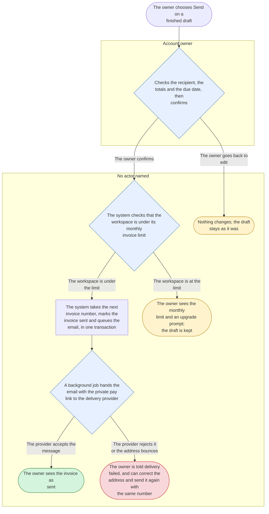
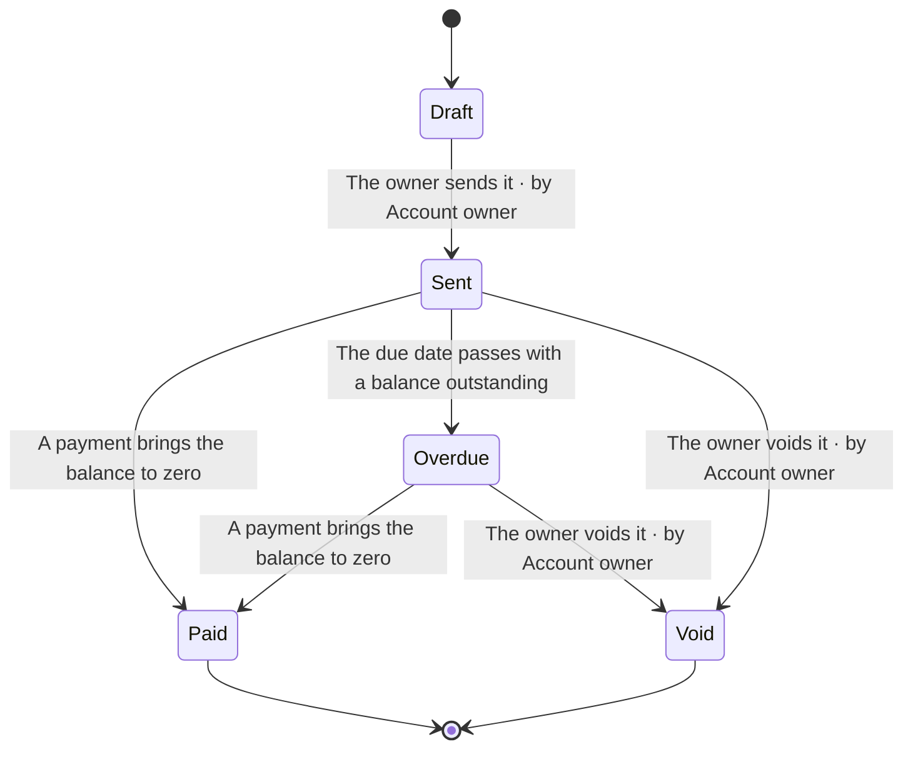
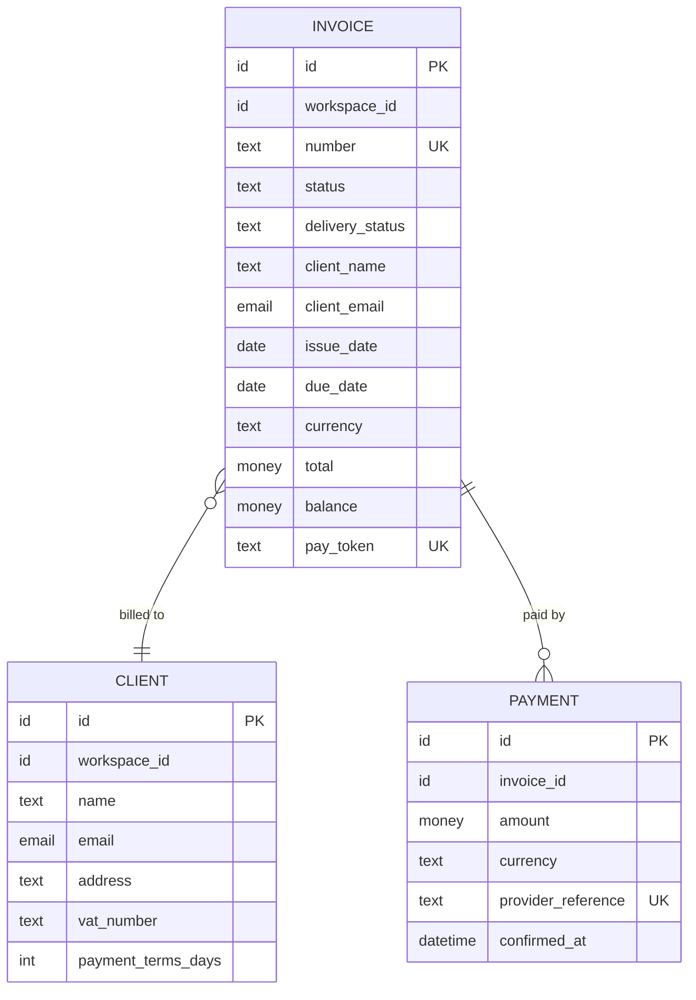

<!-- Generated by pds (spec FEAT-send-invoice). Do not edit: change the records and regenerate. -->

# Feature specification: Send an invoice

> Finish a draft, check who it goes to and what it totals, and send it with a private pay link.

|  |  |
| --- | --- |
| Id | `FEAT-send-invoice` |
| Belongs to | Ledgerly › Invoicing and clients › Invoicing |
| Kind | user_facing |
| Tier | 1 |
| Owner | Dana Whitfield |
| Maturity | verifiable supported · specified claimed |
| Approval | approved by Dana Whitfield on 2026-10-27, covering the 13 elements beneath it |
| Reviewed | 2026-10-27 |

## 1. Purpose and value

An owner who has finished a draft sends it to the client in one confirmed action. The product's first value moment ([`OBJ-first-value`](../definition/intent/OBJ-first-value.md)) is this action succeeding for a real invoice.

Out of scope here: creating the draft itself ([`FEAT-draft-invoice`](../definition/structure/FEAT-draft-invoice.md)), taking payment ([`FEAT-pay-invoice-online`](../definition/structure/FEAT-pay-invoice-online.md)), reminders, and sending on a schedule.

**Serves:** [`OBJ-first-value`](../definition/intent/OBJ-first-value.md) New customers send an invoice in their first week; [`OPP-late-payment`](../definition/intent/OPP-late-payment.md) Freelancers wait weeks for money they have already earned

**For:** Account owner, Client

## 2. Entry and access

Reached from a draft invoice. The invoice must have a client with an email address and at least one line. The owner must hold [`PERM-send-invoice`](../definition/actors/PERM-send-invoice.md). If the workspace is at its monthly limit ([`ENTL-monthly-invoices`](../definition/commercial/ENTL-monthly-invoices.md)) the action is replaced by an upgrade prompt ([`FEAT-upgrade-plan`](../definition/structure/FEAT-upgrade-plan.md)). The first thing the owner sees is the review screen ([`SCR-invoice-review`](../definition/experience/SCR-invoice-review.md)).

**Permissions needed**

| Permission | Roles that hold it |
| --- | --- |
| [`PERM-send-invoice`](../definition/actors/PERM-send-invoice.md) Send an invoice | Owner |

**Plan gating**

| Entitlement | Kind | Plans and values |
| --- | --- | --- |
| [`ENTL-monthly-invoices`](../definition/commercial/ENTL-monthly-invoices.md) Invoices sent per month | limit | Free: 5; Team: unlimited |

## 3. Flows

### Send an invoice

From the owner confirming a finished draft to the client's email being handed to the provider.

The number is assigned and the email queued in one transaction, so a delivery problem can never waste an invoice number ([`DEC-sequential-invoice-numbers`](../definition/change/DEC-sequential-invoice-numbers.md)). Delivery is a background step: the owner sees "sent" as soon as the transaction commits and is told afterwards if the email cannot be delivered.

## 4. Screens and messages

**Screens**

| Screen | Kind | Surface | States |
| --- | --- | --- | --- |
| [`SCR-invoice-review`](../definition/experience/SCR-invoice-review.md) Invoice review | page | Ledgerly web app | loading, ready, empty, error, over-limit |

**Messages**

| Message | Channel | Class | Sent when | To |
| --- | --- | --- | --- | --- |
| [`MSG-invoice-email`](../definition/experience/MSG-invoice-email.md) Invoice email | email | transactional | Invoice sent | Client |

## 5. Business rules

### When a plan change affects sending

`RULE-plan-change-timing`

A workspace may send invoices up to the monthly limit of the plan it is on when it sends; a downgrade, a cancellation or an ended trial takes effect at the end of the paid period, the Free limit counts from the first day of the calendar month after that, and invoices already sent are never affected.

| Case | Given | Then |
| --- | --- | --- |
| positive | A Team workspace that cancelled on 10 March with a paid period ending on 31 March sends its twelfth invoice of the month on 20 March | The invoice is sent, because the workspace is still on Team |
| edge | The same workspace sends on 2 April, when it is on Free and has sent nothing yet that month | It may send five invoices in April and is blocked from the sixth |
| edge | A paid period that ends on 15 March | The Free limit still counts only from 1 April, so sending between 16 and 31 March is not limited |
| negative | A Free workspace that has already sent five invoices this month starts a sixth | Sending is blocked, the draft is kept and an upgrade is offered |

### How an invoice total is calculated

`RULE-invoice-total` · shared, lives under Invoicing

A line amount is its quantity times its unit price rounded half up to the cent; line tax is the line amount times the line's tax rate rounded half up to the cent; the invoice total is the sum of all line amounts and all line tax amounts. Quantities have at most three decimals and unit prices at most two.

| Case | Given | Then |
| --- | --- | --- |
| positive | Three hours at 85.00 with 21% tax | The line amount is 255.00, the tax 53.55 and the total 308.55 |
| edge | A quantity of 0.333 hours at 85.00 with 21% tax | The line amount is 28.31 (28.305 rounded half up), the tax 5.95 (5.9451 rounded) and the total 34.26 |
| negative | A line with a negative quantity | The invoice cannot be saved as ready; credits are made with a credit note, which is not yet supported |

### How an invoice number is formed

`RULE-invoice-number-sequence` · shared, lives under Invoicing

An invoice number is INV- followed by a four-digit counter that starts at 0001 and goes up by one for each invoice sent by the workspace; it is taken at the moment of sending and is never reused, not even after the invoice is voided.

| Case | Given | Then |
| --- | --- | --- |
| positive | A workspace that has sent three invoices sends a fourth | The fourth is numbered INV-0004 |
| edge | A draft is deleted before it was ever sent | No number was consumed, and the next invoice sent takes the next number with no gap |
| edge | Two members send invoices at the same moment | They receive two different consecutive numbers, never the same one |
| negative | An owner tries to type an invoice number by hand | The number is read-only and the attempt is refused |

## 6. State

### Invoice lifecycle

## 7. Data

| Entity | Operations | Personal data | Classification | Retention |
| --- | --- | --- | --- | --- |
| [`ENT-invoice`](../definition/information/ENT-invoice.md) Invoice | update | yes | confidential | Seven years from the end of the financial year of the invoice, as tax law requires |

## 8. Events and integrations

| Direction | Event | By |
| --- | --- | --- |
| emits | [`EVT-invoice-sent`](../definition/information/EVT-invoice-sent.md) Invoice sent | [`FEAT-send-invoice`](../definition/structure/FEAT-send-invoice.md), [`FLW-send-invoice`](../definition/experience/FLW-send-invoice.md) |
| consumes | [`EVT-invoice-sent`](../definition/information/EVT-invoice-sent.md) Invoice sent | [`MSG-invoice-email`](../definition/experience/MSG-invoice-email.md) |

**Depends on**

| Element | Type |
| --- | --- |
| [`INT-email-sending`](../definition/information/INT-email-sending.md) Email sending | INT |

## 9. Requirements

| Requirement | Kind | Priority | Verification | Statement |
| --- | --- | --- | --- | --- |
| [`REQ-confirm-recipient`](../definition/behaviour/REQ-confirm-recipient.md) | functional | must | test | When the owner chooses Send, the system shall require explicit confirmation on a screen that shows the recipient's name, email address and the invoice total. |
| [`REQ-email-handoff-time`](../definition/behaviour/REQ-email-handoff-time.md) | quality: performance | should | test | When an invoice is sent, the system shall hand its email to the delivery provider within 30 seconds in at least 99% of sends. |
| [`REQ-send-checks-permission`](../definition/behaviour/REQ-send-checks-permission.md) | functional | must | test | When the owner confirms sending, the system shall check that the owner still holds permission to send invoices in that workspace at that moment. |

## 10. Concerns

| Probe | Disposition | Detail |
| --- | --- | --- |
| Failure paths | addressed | [`FLW-send-invoice`](../definition/experience/FLW-send-invoice.md) |
| First use and empty state | addressed | [`SCR-invoice-review`](../definition/experience/SCR-invoice-review.md) |
| Concurrency and duplicates | addressed | [`RULE-invoice-number-sequence`](../definition/behaviour/RULE-invoice-number-sequence.md), [`FLW-send-invoice`](../definition/experience/FLW-send-invoice.md) |
| Deletion and retention | addressed | [`STM-invoice-lifecycle`](../definition/behaviour/STM-invoice-lifecycle.md) |
| Audit trail | deferred | The first release keeps an invoice's state and dates but no log of who did what. (until [`QST-audit-log`](../definition/change/QST-audit-log.md)) |
| Limits and quotas | addressed | [`ENTL-monthly-invoices`](../definition/commercial/ENTL-monthly-invoices.md) |
| Lists, search and bulk actions | na | Sending acts on one invoice from its own review screen; finding and filtering invoices is a separate feature. |
| Getting data in and out | na | Sending has no data of its own to bring in or take out; exporting invoices belongs with the invoice list. |
| Accessibility | addressed | [`SCR-invoice-review`](../definition/experience/SCR-invoice-review.md), [`OBL-accessibility`](../definition/assurance/OBL-accessibility.md) |
| Localisation | deferred | The first release is English only; amounts and dates follow the workspace's country format. (until 2027-06-30) |
| Performance and volume | addressed | [`REQ-email-handoff-time`](../definition/behaviour/REQ-email-handoff-time.md) |
| Observability | addressed | [`MET-delivery-rate`](../definition/operations/MET-delivery-rate.md) |
| Rollout and migration | addressed | [`RLS-first-release`](../definition/change/RLS-first-release.md) |
| Product analytics | addressed | [`MET-activation-rate`](../definition/operations/MET-activation-rate.md) |
| Abuse and misuse | addressed | [`RISK-invoice-abuse`](../definition/assurance/RISK-invoice-abuse.md) |
| Personal data | deferred | How owners answer a client's request to see, correct or erase their data is not decided. (until [`QST-client-data-requests`](../definition/change/QST-client-data-requests.md)) |
| Tenant isolation | addressed | [`REQ-workspace-data-isolation`](../definition/behaviour/REQ-workspace-data-isolation.md), [`TST-workspace-isolation`](../definition/assurance/TST-workspace-isolation.md) |
| Tenant states | addressed | [`RULE-plan-change-timing`](../definition/behaviour/RULE-plan-change-timing.md) |
| Sessions and revoked access | addressed | [`REQ-send-checks-permission`](../definition/behaviour/REQ-send-checks-permission.md) |
| Plan gating | addressed | [`ENTL-monthly-invoices`](../definition/commercial/ENTL-monthly-invoices.md) |
| Billing impact | addressed | [`RULE-invoice-total`](../definition/behaviour/RULE-invoice-total.md), [`TST-invoice-total`](../definition/assurance/TST-invoice-total.md) |
| Usage metering | addressed | [`ENTL-monthly-invoices`](../definition/commercial/ENTL-monthly-invoices.md), [`EVT-invoice-sent`](../definition/information/EVT-invoice-sent.md) |
| When a dependency fails | addressed | [`FLW-send-invoice`](../definition/experience/FLW-send-invoice.md) |
| Event delivery | addressed | [`EVT-invoice-sent`](../definition/information/EVT-invoice-sent.md) |
| Message preferences and delivery | addressed | [`MSG-invoice-email`](../definition/experience/MSG-invoice-email.md) |

## 11. Verification

| Test | Kind | Level | Automation | Result | Verifies |
| --- | --- | --- | --- | --- | --- |
| [`TST-confirm-and-send`](../definition/assurance/TST-confirm-and-send.md) Confirming sends the invoice exactly once | scenario | e2e | planned | unknown | [`FEAT-send-invoice`](../definition/structure/FEAT-send-invoice.md), [`REQ-confirm-recipient`](../definition/behaviour/REQ-confirm-recipient.md), [`REQ-send-checks-permission`](../definition/behaviour/REQ-send-checks-permission.md), [`FLW-send-invoice`](../definition/experience/FLW-send-invoice.md), [`SCR-invoice-review`](../definition/experience/SCR-invoice-review.md) |
| [`TST-email-handoff-time`](../definition/assurance/TST-email-handoff-time.md) Invoice emails reach the provider within 30 seconds | performance | monitoring | planned | unknown | [`REQ-email-handoff-time`](../definition/behaviour/REQ-email-handoff-time.md) |
| [`TST-plan-change-timing`](../definition/assurance/TST-plan-change-timing.md) A plan change affects sending only when it should | scenario | integration | planned | unknown | [`RULE-plan-change-timing`](../definition/behaviour/RULE-plan-change-timing.md) |

## 12. Decisions, assumptions, questions and risks

| Type | Entry | Status |
| --- | --- | --- |
| RISK | [`RISK-wrong-recipient`](../definition/assurance/RISK-wrong-recipient.md) An invoice goes to the wrong client | mitigating |
| QST | [`QST-audit-log`](../definition/change/QST-audit-log.md) Do workspaces with several members need an audit log? | open |
| RISK | [`RISK-invoice-abuse`](../definition/assurance/RISK-invoice-abuse.md) Sending is used to spam or phish strangers | accepted |
| QST | [`QST-client-data-requests`](../definition/change/QST-client-data-requests.md) What happens when a client asks to see or erase their data? | open |

## 13. Release and maintenance

Behind the `send-invoice` flag during the closed beta, on for all workspaces at launch. Monitored by the sent-to-delivered ratio and by sends rejected for number conflicts, which must stay at zero. Switching the flag off hides Send but leaves existing invoices and links working. Retiring the feature would require a plan for invoices already in the sent state.

**Planned in:** [`RLS-first-release`](../definition/change/RLS-first-release.md) First release

## Completeness

At the top rung.
