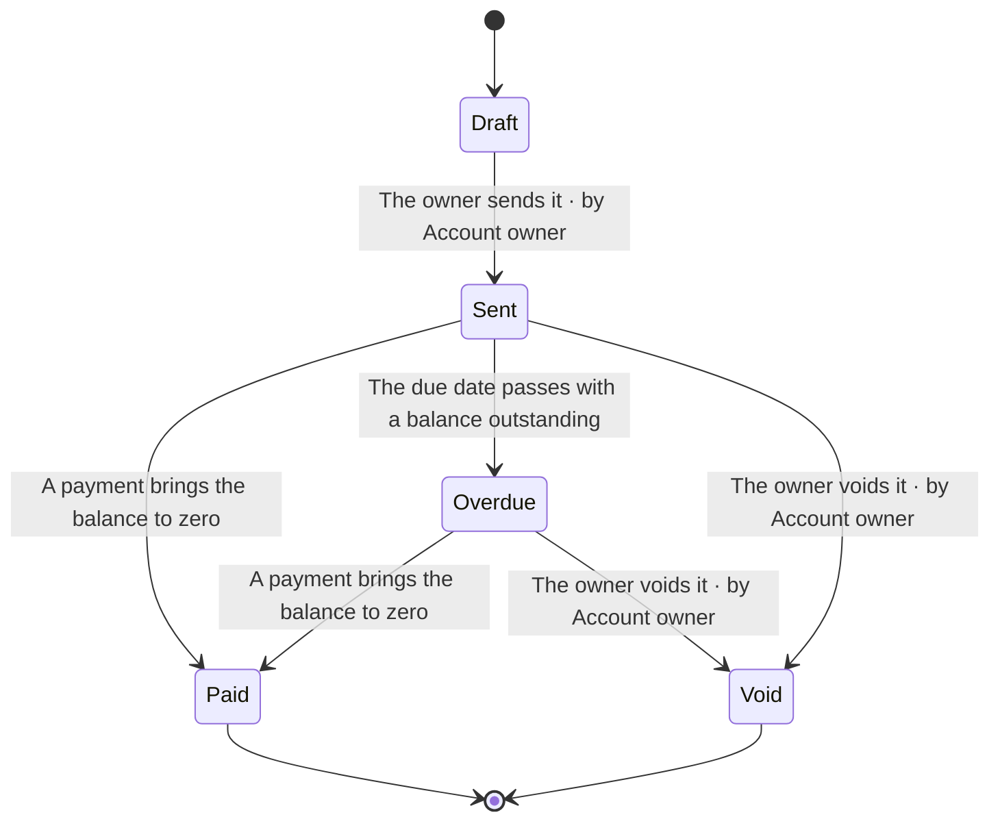

<!-- Generated by pds (state). Do not edit: change the records and regenerate. -->

# State diagram: Ledgerly

## Invoice lifecycle

`STM-invoice-lifecycle` · verifiable (claims specified) · describes Invoice

**States**

| State | Kind | Meaning |
| --- | --- | --- |
| `draft` | initial | Draft: Being written; the client cannot see it and it has no number |
| `sent` | normal | Sent: Numbered and payable once it has been emailed |
| `overdue` | normal | Overdue: Past its due date with a balance outstanding |
| `paid` | terminal | Paid: The balance is zero |
| `void` | terminal | Void: Cancelled by the owner and the number is kept |

**Transitions**

| From | To | Caused by | Who | Guard | Emits |
| --- | --- | --- | --- | --- | --- |
| `draft` | `sent` | The owner sends it | Account owner | How an invoice number is formed | Invoice sent |
| `sent` | `paid` | A payment brings the balance to zero | system |  | Invoice paid |
| `sent` | `overdue` | The due date passes with a balance outstanding | system |  |  |
| `overdue` | `paid` | A payment brings the balance to zero | system |  | Invoice paid |
| `sent` | `void` | The owner voids it | Account owner |  |  |
| `overdue` | `void` | The owner voids it | Account owner |  |  |
